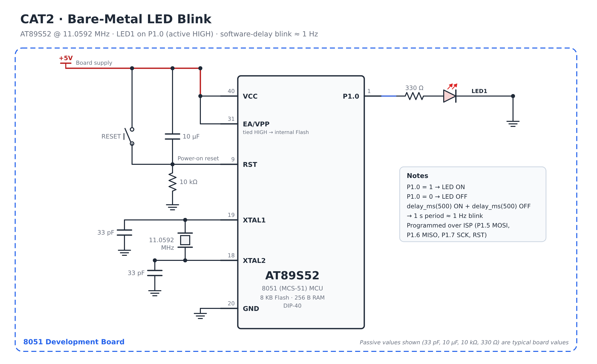

# EXPERIMENT DETAILS

**EXP:** CONTINUOUS ASSESSMENT 2

**DATE:** 20/07/2026

**NAME OF EXP:** 8051 Tool Chain Setup – Development Board – AT89S52

**HARDWARE SETUP / PLATFORM:** 8051 Development Board (AT89S52 @ 11.0592 MHz) + Keil µVision (C51)

---

## TASK 2A : Bare-Metal LED Blink

### 1. Circuit Diagram

The on-board LED connected to P1.0 is blinked by writing directly to the Port 1 SFR (no Arduino APIs, HAL or RTOS).

- **Development Board:** 8051 Development Board
- **Microcontroller IC:** AT89S52 (8051 / MCS-51 core, DIP-40)
- **Clock:** 11.0592 MHz crystal on XTAL1 (pin 19) / XTAL2 (pin 18)
- **GPIO Port / Pin:** Port 1, P1.0 (pin 1)
- **Peripheral:** LED1 with current-limiting resistor (active HIGH)
- **Power Supply:** +5 V on VCC (pin 40), GND (pin 20), EA/VPP (pin 31) tied HIGH

**Hardware Bring-Up Sheet**

| Parameter | Student Entry |
|---|---|
| MCU | AT89S52 |
| CPU Core | 8051 (MCS-51), 8-bit |
| Operating Voltage | 5 V |
| Debug Interface | ISP (In-System Programming) over SPI: P1.5 MOSI, P1.6 MISO, P1.7 SCK, RST |
| LED GPIO Port | Port 1 |
| LED GPIO Pin | P1.0 |
| LED Active State | Active HIGH (P1.0 = 1 → LED ON) |
| LED Frequency (Hz) | ≈ 1 Hz (500 ms ON + 500 ms OFF) |

### 2. Core Logic / Pseudocode / Code Base

**Working Principle:**

P1.0 is declared as a single bit of the Port 1 SFR. Writing `1` drives the pin HIGH and turns the LED on; writing `0` turns it off. A software delay of 500 ms between the two writes gives a 1 s period, so the LED blinks at about 1 Hz.

**Pseudocode:**

1. Include `reg52.h` (8051 SFR definitions) and the custom `delay.h`.
2. Map the LED to P1.0 using `sbit LED = P1^0`.
3. Set `LED = 1` (LED ON).
4. Call `delay_ms(500)`.
5. Set `LED = 0` (LED OFF).
6. Call `delay_ms(500)`.
7. Repeat forever.

**Code Base:** [`main.c`](main.c)

- `sbit LED = P1^0;` gives bit-level access to P1.0.
- `LED = 1` / `LED = 0` write the port bit directly.
- `delay_ms()` comes from the custom delay library (TASK 2B).

### 3. Inference

The LED on P1.0 blinks continuously at about 1 Hz. The experiment shows the full tool chain (Keil C51 project → hex file → ISP programming) and direct register-level GPIO output control on the AT89S52.

---

## TASK 2B : Customised Library Function for Delay

### 1. Circuit Diagram

Same hardware as TASK 2A (LED1 on P1.0). See the circuit diagram above.

### 2. Core Logic / Pseudocode / Code Base

**Working Principle:**

The delay routine is moved into its own module (`delay.c` + `delay.h`) so any program can reuse it. It burns CPU time with nested loops: the outer loop runs once per millisecond requested and the inner loop takes about 1 ms.

At 11.0592 MHz one machine cycle is 12 / 11.0592 MHz ≈ 1.085 µs. One pass of the empty inner loop takes about 4 machine cycles (≈ 4.34 µs), so about 230 passes ≈ 1 ms.

**Pseudocode:**

1. `delay.h` declares `void delay_ms(unsigned int ms);` inside an include guard.
2. `delay.c` defines `delay_ms(ms)`:
   - outer loop `i = 0 … ms − 1`
   - inner loop `j = 0 … 229` (≈ 1 ms)
3. `main.c` includes `delay.h` and calls `delay_ms(500)`.

**Code Base:** [`delay.h`](delay.h), [`delay.c`](delay.c)

- `#ifndef DELAY_H / #define DELAY_H / #endif` stops the header from being included twice.
- `unsigned int` loop counters (16-bit on the 8051) keep both loop limits small and easy to tune.
- The project [`LED_BLINK.uvproj`](LED_BLINK.uvproj) compiles `STARTUP.A51`, `main.c` and `delay.c` together.

### 3. Inference

Putting the delay in a separate library keeps `main.c` short and lets later experiments reuse the same function. A software delay keeps the CPU busy and depends on the crystal and the compiler's loop code, so its timing is approximate; hardware timers (CAT5) give exact timing.
