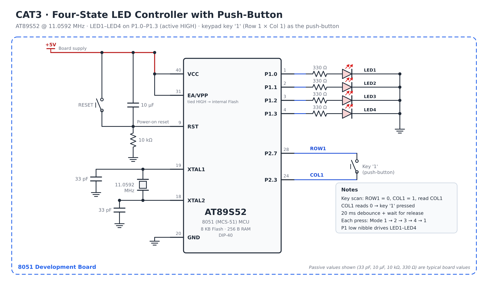

# EXPERIMENT DETAILS

**EXP:** CONTINUOUS ASSESSMENT 3

**DATE:** 27/07/2026

**NAME OF EXP:** Timer-Based LED Pattern Generator and Button Interrupt Controller

**HARDWARE SETUP / PLATFORM:** 8051 Development Board (AT89S52 @ 11.0592 MHz) + Keil µVision (C51) · 4 LEDs + push-button

---

## TASK 3A : Four-State LED Control System

### 1. Circuit Diagram

Four LEDs are GPIO outputs and one push-button is a GPIO input. Each valid press moves the system to the next LED mode.

- **Development Board:** 8051 Development Board
- **Microcontroller IC:** AT89S52 (8051 / MCS-51 core, DIP-40)
- **Clock:** 11.0592 MHz crystal on XTAL1 (pin 19) / XTAL2 (pin 18)
- **LED outputs:** LED1–LED4 on P1.0–P1.3 (pins 1–4), active HIGH
- **Push-button input:** key '1' of the on-board keypad, between ROW1 = P2.7 (pin 28) and COL1 = P2.3 (pin 24)
- **Power Supply:** +5 V on VCC (pin 40), GND (pin 20), EA/VPP (pin 31) tied HIGH

### 2. Core Logic / Pseudocode / Code Base

**Working Principle:**

The program is a four-state machine stored in the variable `mode`. To read the button, ROW1 is driven LOW and COL1 is read: COL1 = 0 means the key is pressed. A press is accepted only if it is still there after a 20 ms debounce, and the code waits for release, so one physical press gives exactly one state change.

While a pattern is running, `check_key_delay()` waits in 10 ms slices and checks the button in every slice. A press during a pattern is caught straight away instead of after the pattern finishes.

| Mode | LED pattern (P1.3–P1.0) | Step time |
|---|---|---|
| 0 (start) | All OFF, waiting for the first press | — |
| 1 · Running LED | 0001 → 0010 → 0100 → 1000 → … | 300 ms |
| 2 · Binary Counter | 0000 → 0001 → … → 1111 → 0000 | 300 ms |
| 3 · Alternating Pattern | 1010 ↔ 0101 | 300 ms |
| 4 · All LED Flash | 1111 ↔ 0000 | 300 ms |

**Pseudocode:**

1. Map keypad ROW1–ROW4 to P2.7–P2.4 and COL1–COL4 to P2.3–P2.0.
2. Start with `mode = 0` and `P1 = 0x00` (all LEDs OFF).
3. `is_key1_pressed()`: ROW1 = 0, other rows = 1, COL1 = 1; return 1 if COL1 reads 0.
4. `check_key_delay(ms)`: repeat every 10 ms until `ms` has passed:
   - if key 1 is pressed → wait 20 ms → if still pressed, wait for release and return 1
   - otherwise return 0 at the end
5. Main loop:
   - Mode 0: on a debounced press → mode 1
   - Mode 1: `P1 = 1 << i` for i = 0…3; a press → mode 2
   - Mode 2: `P1 = count` for count = 0…15; a press → mode 3
   - Mode 3: `P1 = 0x0A`, then `0x05`; a press → mode 4
   - Mode 4: `P1 = 0x0F`, then `0x00`; a press → mode 1
6. Repeat forever.

**Code Base:** [`led_pattern_controller.c`](led_pattern_controller.c)

- `sbit ROW1 = P2^7 … COL4 = P2^0` give bit access to the keypad lines.
- `delay_ms()`: nested-loop delay, 112 inner passes ≈ 1 ms on this board.
- `is_key1_pressed()`: one-key scan of the matrix (ROW1 × COL1).
- `check_key_delay()`: pattern delay that keeps polling the button, with debounce and release wait.
- Writing to the whole Port 1 (`P1 = …`) updates all four LEDs at once.
- Firmware: [`Objects/LED_PATTERN_CONTROLLER.hex`](Objects/LED_PATTERN_CONTROLLER.hex), built from [`LED_PATTERN_CONTROLLER.uvproj`](LED_PATTERN_CONTROLLER.uvproj).

### 3. Inference

The LEDs start OFF. Each press of the button moves the board through running LED → binary counter → alternating pattern → all-LED flash and back to running LED.

Debounce plus waiting for release gives exactly one transition per press. Checking the button every 10 ms inside the pattern delay keeps the system responsive. The experiment covers register-level GPIO input/output, switch debouncing and state-machine design on the 8051.
