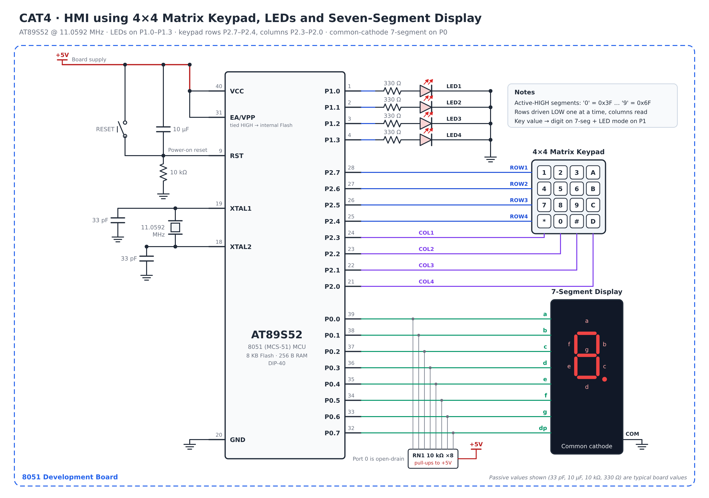

# EXPERIMENT DETAILS

**EXP:** CONTINUOUS ASSESSMENT 4

**DATE:** 03/08/2026

**NAME OF EXP:** Human-Machine Interface using Matrix Keypad, LEDs, and Seven-Segment Display

**HARDWARE SETUP / PLATFORM:** 8051 Development Board (AT89S52 @ 11.0592 MHz) + Keil µVision (C51) · 4×4 keypad + 7-segment display + 4 LEDs

---

## TASK 4A : Keypad-Controlled Seven-Segment Display and LED Functions

### 1. Circuit Diagram

The keypad is the input device. The seven-segment display shows the pressed key, and the LEDs run the function chosen by that key.

- **Development Board:** 8051 Development Board
- **Microcontroller IC:** AT89S52 (8051 / MCS-51 core, DIP-40)
- **Clock:** 11.0592 MHz crystal on XTAL1 (pin 19) / XTAL2 (pin 18)
- **4×4 Matrix Keypad:** rows R1–R4 on P2.7–P2.4 (pins 28–25), columns C1–C4 on P2.3–P2.0 (pins 24–21)
- **Seven-Segment Display:** common cathode, segments a–g, dp on P0.0–P0.7 (pins 39–32), with pull-ups because Port 0 is open-drain
- **LEDs:** LED1–LED4 on P1.0–P1.3 (pins 1–4), active HIGH
- **Power Supply:** +5 V on VCC (pin 40), GND (pin 20), EA/VPP (pin 31) tied HIGH

### 2. Core Logic / Pseudocode / Code Base

**Working Principle:**

The keypad is scanned one row at a time. The active row is driven LOW, the others HIGH, and the four columns are read: a column reading 0 gives the key at that row/column, looked up in a 4×4 table kept in code memory. A key is accepted only if the same key is still read after 20 ms (debounce). The program then waits for release.

The accepted key becomes the current mode. It is shown on the seven-segment display and selects the LED function:

| Key | 7-Segment | P0 code | LED operation (P1) |
|---|---|---|---|
| 1 | 1 | 0x06 | LED1 ON (0x01) |
| 2 | 2 | 0x5B | LED2 ON (0x02) |
| 3 | 3 | 0x4F | LED3 ON (0x04) |
| 4 | 4 | 0x66 | LED4 ON (0x08) |
| 5 | 5 | 0x6D | Running LED pattern, 300 ms per step |
| 6 | 6 | 0x7D | Alternate LEDs 1010 ↔ 0101, 300 ms |
| 7 | 7 | 0x07 | Binary counter 0–15, 300 ms per count |
| 8 | 8 | 0x7F | All LEDs blink, 250 ms ON / 250 ms OFF |
| 9 | 9 | 0x6F | All LEDs OFF |
| 0 | 0 | 0x3F | Reset system (all LEDs OFF, display 0) |

The animated modes (5–8) wait using `check_key_delay()`, which scans the keypad every 10 ms. A new key interrupts the running pattern immediately.

**Pseudocode:**

1. Define `KEY_PAD[4][4] = {1 2 3 A / 4 5 6 B / 7 8 9 C / * 0 # D}` in code memory.
2. At start: `P1 = 0x00` (LEDs OFF), `P0 = 0x3F` (display shows 0).
3. `scan_keypad()`: for each row r = 0…3:
   - make row r LOW and the other rows HIGH
   - set all columns HIGH (input)
   - if a column reads 0 → return `KEY_PAD[r][column]`
   - if no key is found, return 0
4. Main loop:
   - read a key; if one is found, wait 20 ms and confirm it is the same key
   - `mode = key`, call `display_digit(mode)`, wait for release
   - run the LED function for `mode` (table above)
5. `check_key_delay(ms)`: delay in 10 ms steps and return 1 as soon as a debounced key is seen.
6. Repeat forever.

**Code Base:** [`keypad_7seg_hmi.c`](keypad_7seg_hmi.c)

- `KEY_PAD[4][4]` (stored with `code`): key lookup table in program memory.
- `scan_keypad()`: row-by-row matrix scan that returns the ASCII key or 0.
- `display_digit()`: maps '0'–'9' to the common-cathode segment code on P0 (other keys blank the display).
- `check_key_delay()`: pattern delay that keeps scanning the keypad, so a running pattern can be interrupted by a new key.
- `delay()`: nested-loop delay, about 1 ms per count.
- Firmware: [`Objects/KEYPAD_7SEG_HMI.hex`](Objects/KEYPAD_7SEG_HMI.hex), built from [`KEYPAD_7SEG_HMI.uvproj`](KEYPAD_7SEG_HMI.uvproj).

### 3. Inference

Pressing a digit key shows the same digit on the seven-segment display and starts the matching LED function. Keys 1–4 light single LEDs, 5–8 run the animated patterns, 9 turns the LEDs off and 0 resets the system.

Row scanning detects all 16 keys with only 8 port pins. Debouncing gives one action per press, and polling the keypad inside the pattern delays keeps the interface responsive. The experiment combines matrix keypad input, seven-segment output and LED control into a simple embedded HMI.
