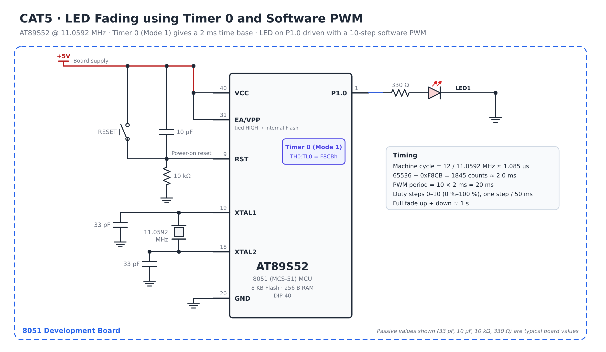

# EXPERIMENT DETAILS

**EXP:** CONTINUOUS ASSESSMENT 5

**DATE:** 10/08/2026

**NAME OF EXP:** Hardware Timer and Interrupt-Based Timing for LED Fading, Pulse Generation, and Stepper Motor Control

**HARDWARE SETUP / PLATFORM:** 8051 Development Board (AT89S52 @ 11.0592 MHz) + Keil µVision (C51) · LED on P1.0 · Timer 0

---

## TASK 5A : LED Fading using Software PWM

### 1. Circuit Diagram

Timer 0 provides a hardware time base. A software PWM signal on P1.0 fades the LED from 0 % to 100 % brightness and back, with no software delay loops.

- **Development Board:** 8051 Development Board
- **Microcontroller IC:** AT89S52 (8051 / MCS-51 core, DIP-40)
- **Clock:** 11.0592 MHz crystal on XTAL1 (pin 19) / XTAL2 (pin 18)
- **Timer:** Timer 0, Mode 1 (16-bit), on-chip
- **GPIO Pin:** P1.0 (pin 1), PWM output
- **Peripheral:** LED1 with current-limiting resistor (active HIGH)
- **Power Supply:** +5 V on VCC (pin 40), GND (pin 20), EA/VPP (pin 31) tied HIGH

### 2. Core Logic / Pseudocode / Code Base

**Working Principle:**

**Timer 0 time base:** a 12-clock 8051 at 11.0592 MHz counts once every 1.085 µs. Loading TH0:TL0 = 0xF8CB leaves 65536 − 63691 = 1845 counts to overflow, so Timer 0 overflows every 1845 × 1.085 µs ≈ **2 ms**. Each overflow (TF0 = 1) is one tick. The timer is reloaded on every tick.

**Software PWM:** `pwm_count` counts ticks from 0 to 9, so one PWM period is 10 × 2 ms = 20 ms (50 Hz). The LED is ON while `pwm_count < duty`. `duty` goes from 0 to 10, which gives brightness from 0 % to 100 % in 10 % steps.

**Fading:** every 25 ticks (50 ms) `duty` moves one step up, until it reaches 10, and then one step down, until it reaches 0. A full fade up and down therefore takes 20 × 50 ms = 1 s.

| Duty | LED brightness |
|---|---|
| 0 % | OFF |
| 30 % | Dim |
| 50 % | Medium |
| 80 % | Bright |
| 100 % | Fully ON |

**Pseudocode:**

1. `TMOD = 0x01` (Timer 0, Mode 1); load `TH0 = 0xF8`, `TL0 = 0xCB`; start with `TR0 = 1`.
2. Forever:
   - if `TF0 == 1` (2 ms tick):
     - stop the timer, clear TF0, reload `0xF8CB`, restart
     - `pwm_count++`; if it reaches 10 → 0
     - `P1.0 = 1` if `pwm_count < duty`, else `P1.0 = 0`
     - `fade_count++`; at 25 → reset it and move `duty` one step (up to 10, then down to 0)

**Code Base:** [`led_fade_pwm.c`](led_fade_pwm.c)

- `TMOD`, `TH0`, `TL0`, `TR0`, `TF0`: Timer 0 SFRs used directly.
- `sbit P1_0 = P1^0`: the PWM output pin.
- `pwm_count`, `duty`: software PWM counter and duty cycle (0–10).
- `fade_count`, `direction`: set the fade speed (one step every 50 ms) and direction (up/down).
- All timing comes from Timer 0 overflows; the code has no delay loops.
- Project: [`LED_FADE_PWM.uvproj`](LED_FADE_PWM.uvproj) (build in Keil to generate `Objects/LED_FADE_PWM.hex`).

### 3. Inference

The LED on P1.0 smoothly brightens from OFF to fully ON and dims back to OFF about once a second, repeating continuously.

Timer 0 generates the 2 ms timing in hardware, and the software only reacts to each overflow. The program needs no software delay loops, so the timing is set by the timer reload value rather than by loop counts. The PWM frequency here is 50 Hz (20 ms period). The experiment demonstrates hardware timer configuration, reload-value calculation and software PWM on the 8051.
