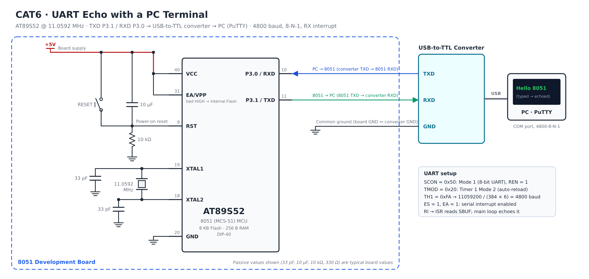

# EXPERIMENT DETAILS

**EXP:** CONTINUOUS ASSESSMENT 6

**DATE:** 17/08/2026

**NAME OF EXP:** UART Driver and Serial Debugging

**HARDWARE SETUP / PLATFORM:** 8051 Development Board (AT89S52 @ 11.0592 MHz) + Keil µVision (C51) · USB-to-TTL converter · PC with PuTTY

---

## TASK 6B : UART Echo

### 1. Circuit Diagram

The 8051's on-chip UART talks to a PC terminal through a USB-to-TTL serial converter. Every character typed in PuTTY is received by the 8051 and sent straight back.

- **Development Board:** 8051 Development Board
- **Microcontroller IC:** AT89S52 (8051 / MCS-51 core, DIP-40)
- **Clock:** 11.0592 MHz crystal on XTAL1 (pin 19) / XTAL2 (pin 18)
- **UART pins:** RXD = P3.0 (pin 10), TXD = P3.1 (pin 11)
- **Peripheral:** USB-to-TTL converter; TX and RX are crossed (8051 TXD → converter RXD, converter TXD → 8051 RXD); common GND
- **Host:** PC running PuTTY on the converter's COM port, 4800 baud, 8 data bits, no parity, 1 stop bit
- **Power Supply:** +5 V on VCC (pin 40), GND (pin 20), EA/VPP (pin 31) tied HIGH

### 2. Core Logic / Pseudocode / Code Base

**Working Principle:**

**Baud rate:** Timer 1 in Mode 2 (8-bit auto-reload) generates the baud clock:

baud = f_osc / (12 × 32 × (256 − TH1)) = 11 059 200 / (384 × 6) = **4800** with TH1 = 0xFA.

The 9600-baud setting (TH1 = 0xFD) is kept in the source as a commented-out `uart_init()`.

**Serial mode:** `SCON = 0x50` selects Mode 1 (8-bit UART, variable baud rate) and sets REN = 1 so reception is enabled.

**Receive (interrupt-driven):** when a byte arrives, the hardware sets RI and raises the serial interrupt (vector 4). The ISR copies `SBUF` into `received`, clears RI and sets `received_flag`.

**Transmit:** the main loop sees `received_flag`, writes the byte back to `SBUF`, waits for TI (transmission finished) and clears it.

**Pseudocode:**

1. `uart_init()`:
   - `TMOD = 0x20` (Timer 1, Mode 2)
   - `TH1 = TL1 = 0xFA` (4800 baud)
   - `SCON = 0x50` (Mode 1, REN = 1)
   - `TR1 = 1` (start Timer 1)
   - `ES = 1`, `EA = 1` (enable the serial interrupt)
2. `uart_ISR()` (interrupt 4): if RI → `received = SBUF`, clear RI, `received_flag = 1`.
3. `uart_tx(c)`: `SBUF = c` → wait until TI = 1 → clear TI.
4. Main loop: if `received_flag` → `uart_tx(received)`, then clear `received_flag`.

**Code Base:** [`uart_echo.c`](uart_echo.c)

- `SCON`, `SBUF`, `TMOD`, `TH1`, `TL1`, `TR1`, `RI`, `TI`, `ES`, `EA`: UART, Timer 1 and interrupt SFRs used directly.
- `uart_init()`: 4800-8-N-1 set-up with the receive interrupt enabled.
- `uart_ISR(void) interrupt 4`: serial ISR that stores the received byte and sets a flag.
- `uart_tx()`: polled transmit of one character.
- Firmware: [`Objects/UART_ECHO.hex`](Objects/UART_ECHO.hex), built from [`UART_ECHO.uvproj`](UART_ECHO.uvproj).

### 3. Inference

With PuTTY set to the converter's COM port at 4800-8-N-1, every character typed is echoed back. Typing `Hello 8051` or `ABC123` shows the same text in the terminal: PC → 8051 → PC.

Reception is interrupt-driven: the ISR only stores the byte and sets a flag, and the main loop sends it back. Both sides must use the same baud rate; Timer 1 auto-reload with an 11.0592 MHz crystal gives exact standard rates (0xFA → 4800, 0xFD → 9600). The experiment demonstrates 8051 UART configuration, Timer 1 baud-rate generation and interrupt-driven serial reception.
