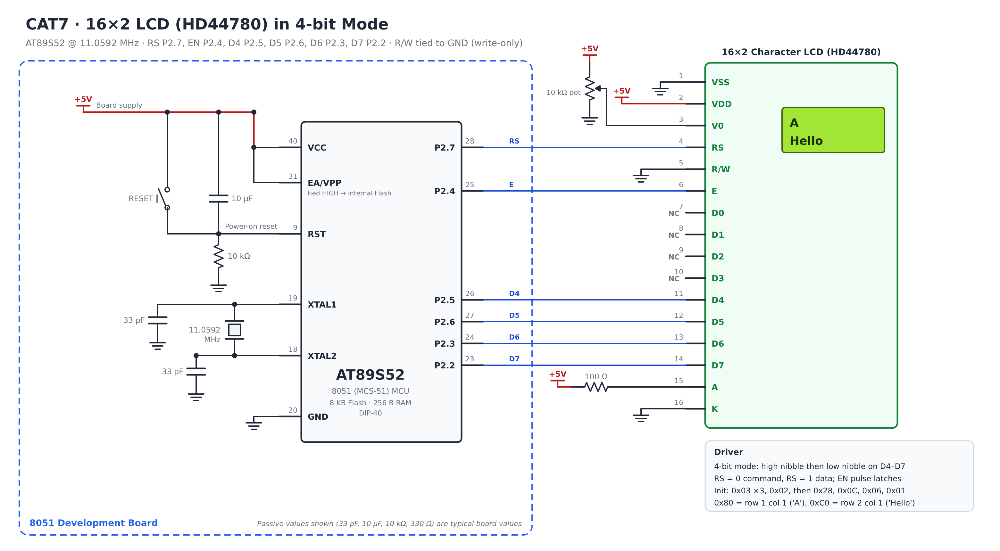

# EXPERIMENT DETAILS

**EXP:** CONTINUOUS ASSESSMENT 7

**DATE:** 24/08/2026

**NAME OF EXP:** 16×2 LCD Driver Development and Dynamic Display Control

**HARDWARE SETUP / PLATFORM:** 8051 Development Board (AT89S52 @ 11.0592 MHz) + Keil µVision (C51) · 16×2 HD44780-compatible LCD

---

## TASK 7A : LCD Initialization and Character/String Display

### 1. Circuit Diagram

A 4-bit GPIO driver for a 16×2 HD44780-compatible LCD. It initialises the display, writes the character `A` at the first position of row 1 and the string `Hello` on row 2.

- **Development Board:** 8051 Development Board
- **Microcontroller IC:** AT89S52 (8051 / MCS-51 core, DIP-40)
- **Clock:** 11.0592 MHz crystal on XTAL1 (pin 19) / XTAL2 (pin 18)
- **LCD control lines:** RS = P2.7 (pin 28), EN = P2.4 (pin 25)
- **LCD data lines (4-bit):** D4 = P2.5 (pin 26), D5 = P2.6 (pin 27), D6 = P2.3 (pin 24), D7 = P2.2 (pin 23); D0–D3 not connected
- **LCD R/W:** tied to GND (write-only)
- **Contrast:** V0 from a 10 kΩ potentiometer; backlight A/K to +5 V / GND
- **Power Supply:** +5 V on VCC (pin 40) and LCD VDD, common GND, EA/VPP (pin 31) tied HIGH

### 2. Core Logic / Pseudocode / Code Base

**Working Principle:**

In 4-bit mode each byte is sent as two nibbles on D4–D7, high nibble first. RS chooses what the byte means: RS = 0 for a command, RS = 1 for character data. A HIGH → LOW pulse on EN makes the LCD latch each nibble.

The initialisation sequence from the HD44780 datasheet puts the controller into 4-bit, 2-line mode:

| Step | Value | Meaning |
|---|---|---|
| Power-up wait | delay(20) | Let the LCD controller start up |
| Wake-up | 0x3, 0x3, 0x3 (nibbles) | Force 8-bit mode three times |
| Interface | 0x2 (nibble) | Switch to the 4-bit interface |
| Function Set | 0x28 | 4-bit, 2 lines, 5×8 font |
| Display Control | 0x0C | Display ON, cursor OFF, blink OFF |
| Entry Mode | 0x06 | Cursor moves right, no display shift |
| Clear Display | 0x01 | Clear DDRAM, cursor to home |

DDRAM addresses select the position: `0x80` = row 1, column 1 and `0xC0` = row 2, column 1.

**Pseudocode:**

1. Map RS, EN and D4–D7 to their P2 pins with `sbit`.
2. `lcd_nibble(n)`: put bits 0–3 of `n` on D4–D7, then pulse EN (1 → delay → 0).
3. `lcd_cmd(cmd)`: RS = 0, send the high nibble then the low nibble, short delay.
4. `lcd_data(d)`: RS = 1, send the high nibble then the low nibble, short delay.
5. `lcd_init()`: run the sequence in the table above.
6. `lcd_puts(str)`: call `lcd_data()` for every character until `'\0'`.
7. Main:
   - `lcd_init()`
   - `lcd_cmd(0x80)`, then `lcd_puts("A")`
   - `lcd_cmd(0xC0)`, then `lcd_puts("Hello")`
   - loop forever

**Code Base:** [`lcd_driver.c`](lcd_driver.c)

- `lcd_init()`, `lcd_cmd()`, `lcd_data()`: the low-level driver required by the task.
- `lcd_nibble()`: writes one 4-bit nibble and generates the EN strobe.
- `lcd_puts()`: string output built on `lcd_data()`.
- `delay()`: nested-loop software delay used for the LCD timing.
- Firmware: [`Objects/LCD_DRIVER.hex`](Objects/LCD_DRIVER.hex), built from [`LCD_DRIVER.uvproj`](LCD_DRIVER.uvproj).

### 3. Inference

After power-up the LCD shows `A` at the first position of row 1 and `Hello` at the start of row 2, so text appears on both rows.

Following the datasheet's command sequence and sending each byte as two nibbles with an EN strobe needs only six GPIO pins. Command bytes (RS = 0) set the mode and cursor position, and data bytes (RS = 1) write characters. The experiment shows how to derive a driver from a peripheral datasheet and check it on hardware.
