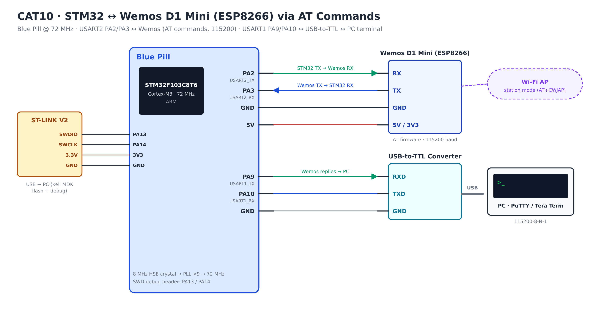

# EXPERIMENT DETAILS

**EXP:** CONTINUOUS ASSESSMENT 10

**DATE:** 05/10/2026

**NAME OF EXP:** STM32–Wemos Wi-Fi Modem Interface Using AT Commands

**HARDWARE SETUP / PLATFORM:** STM32 Blue Pill (STM32F103C8T6 @ 72 MHz) + Wemos D1 Mini (ESP8266, AT firmware) + STM32CubeMX + Keil MDK · USB-to-TTL converter · PC terminal

> The lab sheet prints these tasks as 9A, 9B and 9C; they are numbered 10A, 10B and 10C here to follow the coursework numbering for this assessment. One firmware ([`Core/Src/main.c`](Core/Src/main.c)) runs the complete AT-command sequence, so the same CubeMX / Keil project is placed in each task folder; this README covers the part of it that belongs to this task.

---

## TASK 10A : Establish STM32 ↔ Wemos UART Communication

### 1. Circuit Diagram

Two UARTs are used: USART2 talks to the Wemos (AT commands and replies) and USART1 forwards every reply to the PC terminal.

- **Development Board:** STM32 Blue Pill
- **Microcontroller:** STM32F103C8T6 (ARM Cortex-M3)
- **Clock:** 8 MHz HSE crystal → PLL ×9 → 72 MHz SYSCLK
- **UART2 (STM32 ↔ Wemos):** PA2 = USART2_TX → Wemos RX, PA3 = USART2_RX ← Wemos TX, 115200-8-N-1
- **UART1 (STM32 ↔ PC):** PA9 = USART1_TX → USB-to-TTL RXD, PA10 = USART1_RX ← USB-to-TTL TXD, 115200-8-N-1
- **Wi-Fi Module:** Wemos D1 Mini (ESP8266) running AT firmware; common GND, 5 V / 3.3 V supply from the board
- **Programming / Debug:** ST-LINK V2 over SWD (PA13 SWDIO, PA14 SWCLK)

| UART | Connection | Purpose |
|---|---|---|
| USART2 | STM32 ↔ Wemos | AT commands and responses |
| USART1 | STM32 ↔ PC | Debug / display |

### 2. Core Logic / Pseudocode / Code Base

**Working Principle:**

The STM32 sends `AT\r\n` to the Wemos on USART2 and collects the reply with `HAL_UARTEx_ReceiveToIdle()`. That call keeps receiving until the line goes idle (end of the reply), the buffer is full or the timeout expires, and returns how many bytes arrived. Those bytes are then sent unchanged to the PC on USART1, so the modem's `OK` appears in the terminal.

**Pseudocode:**

1. Clear `buffer`.
2. `HAL_UART_Transmit(&huart2, "AT\r\n")`.
3. `HAL_UARTEx_ReceiveToIdle(&huart2, buffer, 150, &length, 2000)`.
4. `HAL_UART_Transmit(&huart1, buffer, length)` → reply shown on the PC.

**Code Base:** [`Core/Src/main.c`](Core/Src/main.c)

- `cmd1[] = "AT\r\n"`: every AT command ends with CR + LF.
- `HAL_UARTEx_ReceiveToIdle()`: idle-line reception, so replies of any length are captured.
- `sizeof(cmd) - 1`: sends the command without the string's terminating `'\0'`.
- CubeMX configuration: [`LAB10.ioc`](LAB10.ioc) · Keil project: [`MDK-ARM/LAB10.uvprojx`](MDK-ARM/LAB10.uvprojx)
- Firmware: [`MDK-ARM/LAB10/LAB10.hex`](MDK-ARM/LAB10/LAB10.hex)

### 3. Inference

The terminal shows `OK` after `AT`, which proves the two boards are communicating (TX/RX crossed, common ground, matching baud rate).
