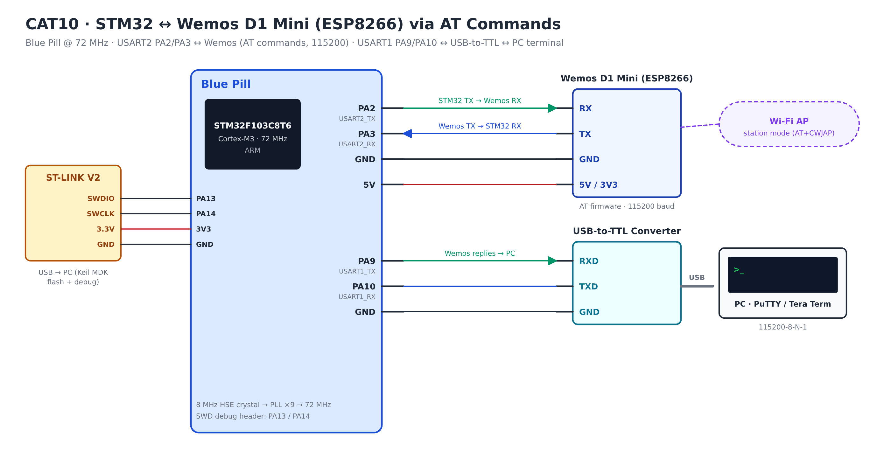

# EXPERIMENT DETAILS

**EXP:** CONTINUOUS ASSESSMENT 10

**DATE:** 05/10/2026

**NAME OF EXP:** STM32–Wemos Wi-Fi Modem Interface Using AT Commands

**HARDWARE SETUP / PLATFORM:** STM32 Blue Pill (STM32F103C8T6 @ 72 MHz) + Wemos D1 Mini (ESP8266, AT firmware) + STM32CubeMX + Keil MDK · USB-to-TTL converter · PC terminal

> The lab sheet prints these tasks as 9A, 9B and 9C; they are numbered 10A, 10B and 10C here to follow the coursework numbering for this assessment. One firmware ([`Core/Src/main.c`](Core/Src/main.c)) runs the complete AT-command sequence, so the same CubeMX / Keil project is placed in each task folder; this README covers the part of it that belongs to this task.

---

## TASK 10B : Explore the ESP8266 AT Command Interface

### 1. Circuit Diagram

The two-UART set-up from TASK 10A is used: USART2 talks to the Wemos (AT commands and replies) and USART1 forwards every reply to the PC terminal.

- **Development Board:** STM32 Blue Pill
- **Microcontroller:** STM32F103C8T6 (ARM Cortex-M3)
- **Clock:** 8 MHz HSE crystal → PLL ×9 → 72 MHz SYSCLK
- **UART2 (STM32 ↔ Wemos):** PA2 = USART2_TX → Wemos RX, PA3 = USART2_RX ← Wemos TX, 115200-8-N-1
- **UART1 (STM32 ↔ PC):** PA9 = USART1_TX → USB-to-TTL RXD, PA10 = USART1_RX ← USB-to-TTL TXD, 115200-8-N-1
- **Wi-Fi Module:** Wemos D1 Mini (ESP8266) running AT firmware; common GND, 5 V / 3.3 V supply from the board
- **Programming / Debug:** ST-LINK V2 over SWD (PA13 SWDIO, PA14 SWCLK)

| UART | Connection | Purpose |
|---|---|---|
| USART2 | STM32 ↔ Wemos | AT commands and responses |
| USART1 | STM32 ↔ PC | Debug / display |

### 2. Core Logic / Pseudocode / Code Base

**Command investigation table:**

| Requirement | Command |
|---|---|
| Check modem response | `AT` |
| Check firmware / version | `AT+GMR` |
| Set Wi-Fi station mode | `AT+CWMODE=1` |
| Scan available networks | `AT+CWLAP` |
| Connect to an AP | `AT+CWJAP="<ssid>","<password>"` |
| Obtain network information | `AT+CIFSR` (IP and MAC address) |
| Establish TCP connection | `AT+CIPSTART="TCP","<host>",<port>` |
| Send application data | `AT+CIPSEND=<length>` → wait for `>` → send the bytes |

Each command is sent as text followed by `\r\n`. The modem answers with the result and `OK`, or `ERROR` / `FAIL`.

**Code Base:** [`Core/Src/main.c`](Core/Src/main.c)

- The firmware uses the station-mode subset of this table: `AT`, `AT+CWMODE=1`, `AT+CWDHCP=1,1`, `AT+CWJAP` and `AT+CIFSR` (`cmd1` … `cmd5`).
- Every command goes out on USART2 (`WIFI_UART`) and every reply is copied to USART1 (`PC_UART`), so each command's result can be read on the PC terminal.
- `HAL_UARTEx_ReceiveToIdle()` captures replies of any length, ending when the line goes idle.
- CubeMX configuration: [`LAB10.ioc`](LAB10.ioc) · Keil project: [`MDK-ARM/LAB10.uvprojx`](MDK-ARM/LAB10.uvprojx)
- Firmware: [`MDK-ARM/LAB10/LAB10.hex`](MDK-ARM/LAB10/LAB10.hex)

### 3. Inference

The AT command set gives the STM32 full control of the Wi-Fi modem over a plain UART: configure, connect, query and send data without any Wi-Fi stack on the STM32 itself.
