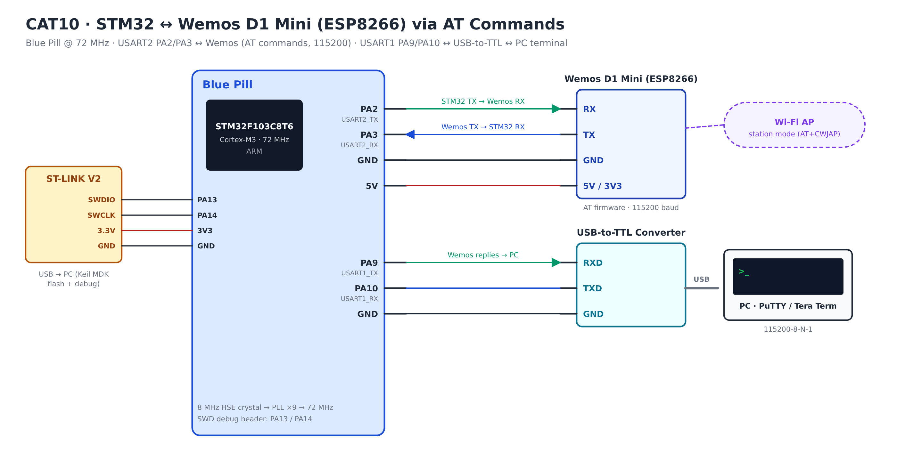

# EXPERIMENT DETAILS

**EXP:** CONTINUOUS ASSESSMENT 10

**DATE:** 05/10/2026

**NAME OF EXP:** STM32–Wemos Wi-Fi Modem Interface Using AT Commands

**HARDWARE SETUP / PLATFORM:** STM32 Blue Pill (STM32F103C8T6 @ 72 MHz) + Wemos D1 Mini (ESP8266, AT firmware) + STM32CubeMX + Keil MDK · USB-to-TTL converter · PC terminal

> The lab sheet prints these tasks as 9A, 9B and 9C; they are numbered 10A, 10B and 10C here to follow the coursework numbering for this assessment. One firmware ([`Core/Src/main.c`](Core/Src/main.c)) runs the complete AT-command sequence, so the same CubeMX / Keil project is placed in each task folder; this README covers the part of it that belongs to this task.

---

## TASK 10C : Connect Wemos to Wi-Fi

### 1. Circuit Diagram

The two-UART set-up from TASK 10A is used, with the Wemos joining the campus 2.4 GHz Wi-Fi network: USART2 talks to the Wemos (AT commands and replies) and USART1 forwards every reply to the PC terminal.

- **Development Board:** STM32 Blue Pill
- **Microcontroller:** STM32F103C8T6 (ARM Cortex-M3)
- **Clock:** 8 MHz HSE crystal → PLL ×9 → 72 MHz SYSCLK
- **UART2 (STM32 ↔ Wemos):** PA2 = USART2_TX → Wemos RX, PA3 = USART2_RX ← Wemos TX, 115200-8-N-1
- **UART1 (STM32 ↔ PC):** PA9 = USART1_TX → USB-to-TTL RXD, PA10 = USART1_RX ← USB-to-TTL TXD, 115200-8-N-1
- **Wi-Fi Module:** Wemos D1 Mini (ESP8266) running AT firmware; common GND, 5 V / 3.3 V supply from the board
- **Programming / Debug:** ST-LINK V2 over SWD (PA13 SWDIO, PA14 SWCLK)

| UART | Connection | Purpose |
|---|---|---|
| USART2 | STM32 ↔ Wemos | AT commands and responses |
| USART1 | STM32 ↔ PC | Debug / display |

### 2. Core Logic / Pseudocode / Code Base

**Working Principle:**

The firmware sends the commands one after another. After each one it waits for the reply and forwards it to the PC, so the whole connection sequence can be checked in the terminal. Joining the network takes several seconds, so `AT+CWJAP` gets a 15 s reply timeout and a further 5 s wait for the IP address to be assigned before `AT+CIFSR`.

| Step | Command | Expected reply | Timeout |
|---|---|---|---|
| 1 | `AT` | `OK` | 2 s |
| 2 | `AT+CWMODE=1` (station mode) | `OK` | 2 s |
| 3 | `AT+CWDHCP=1,1` (enable DHCP) | `OK` | 2 s |
| 4 | `AT+CWJAP="<ssid>","<password>"` | `WIFI CONNECTED`, `WIFI GOT IP`, `OK` | 15 s (+5 s wait) |
| 5 | `AT+CIFSR` | `+CIFSR:STAIP,"<ip>"`, `+CIFSR:STAMAC,…`, `OK` | 3 s |

**Pseudocode:**

1. For each command in the table:
   - clear `buffer`
   - transmit the command on USART2
   - `ReceiveToIdle` on USART2 with that step's timeout
   - transmit the received bytes on USART1 (PC)
   - short delay before the next command
2. After the sequence, the main loop stays idle.

**Code Base:** [`Core/Src/main.c`](Core/Src/main.c)

- `cmd1` … `cmd5`: the AT command strings.
- `#define PC_UART (&huart1)` and `#define WIFI_UART (&huart2)`: role of each UART.
- CubeMX configuration: [`LAB10.ioc`](LAB10.ioc) · Keil project: [`MDK-ARM/LAB10.uvprojx`](MDK-ARM/LAB10.uvprojx)
- Firmware: [`MDK-ARM/LAB10/LAB10.hex`](MDK-ARM/LAB10/LAB10.hex)

### 3. Inference

The terminal shows the full sequence: `OK` for the set-up commands, `WIFI CONNECTED` and `WIFI GOT IP` after joining the network, and the station IP and MAC address from `AT+CIFSR`. This confirms the Wemos is a Wi-Fi station controlled entirely by the STM32.

Joining an access point takes much longer than a normal command, so the reply timeout and the wait after `AT+CWJAP` are what allow the IP address to be read reliably.
