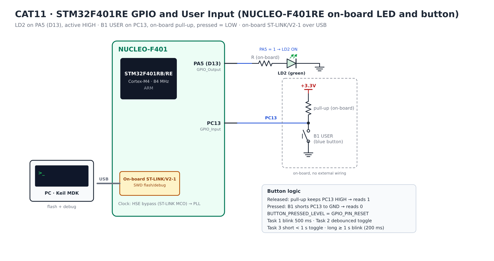

# EXPERIMENT DETAILS

**EXP:** CONTINUOUS ASSESSMENT 11

**DATE:** 14/10/2026

**NAME OF EXP:** STM32F401RE Cortex-M4: GPIO and User Input Programming

**HARDWARE SETUP / PLATFORM:** STM32 NUCLEO-F401RE (STM32F401, ARM Cortex-M4) + STM32CubeMX + Keil MDK · on-board user LED LD2 (PA5) · on-board ST-LINK/V2-1

---

## TASK 11A : On-board LED Bring-Up (Task 1)

### 1. Circuit Diagram

The on-board user LED LD2 is blinked at a fixed interval to verify the NUCLEO-F401RE hardware and the GPIO output configuration. No external components are needed.

- **Development Board:** NUCLEO-F401RE (on-board ST-LINK/V2-1 for programming and debugging over USB)
- **Microcontroller:** STM32F401 (ARM Cortex-M4 with FPU), CubeMX device STM32F401RBTx (LQFP64, same pinout as the F401RE)
- **Clock:** HSE in bypass mode (external clock on PH0 / OSC_IN) → PLL (M = 25, N = 168, P = 2) → 84 MHz SYSCLK on the CubeMX clock tree; AHB ÷1, APB1 ÷2 (42 MHz), APB2 ÷1 (84 MHz), flash latency 2
- **LED (output):** LD2 (green) on PA5 (Arduino D13), push-pull output, active HIGH (PA5 = 1 → LED ON)
- **Programming / Debug:** on-board ST-LINK/V2-1 over SWD (PA13 SWDIO, PA14 SWCLK), USB to the PC

**Controller and board study (prerequisites)**

| Parameter | Observation |
|---|---|
| Controller | STM32F401 (ARM Cortex-M4 with FPU), LQFP64 |
| Maximum CPU clock | 84 MHz |
| Clock sources | HSE (external, used here in bypass mode), HSI 16 MHz RC, LSE 32.768 kHz, LSI ~32 kHz |
| GPIO groups on LQFP64 | Port A (PA0–PA15), Port B (PB0–PB15), Port C (PC0–PC15), PD2, PH0–PH1 |
| UARTs | 3 (USART1, USART2, USART6); USART2 is wired to the ST-LINK virtual COM port |
| I²Cs | 3 (I2C1–I2C3) |
| SPIs | 4 (SPI1–SPI4; SPI2 and SPI3 also support I²S) |
| Other | 12-bit ADC (16 channels), up to 11 timers, USB OTG FS, SDIO |
| User LED | LD2, PA5, active HIGH |
| User button | B1, PC13, active LOW (on-board pull-up) |

**CubeMX pin configuration**

| Pin | Mode | Setting | Used for |
|---|---|---|---|
| PA5 | GPIO_Output | push-pull, no pull, low speed, initial level LOW | LD2 |
| PC13 | GPIO_Input | no pull (pull-up is on the board) | B1 (used in Tasks 2 and 3) |
| PH0 / PH1 | RCC_OSC_IN / OSC_OUT | HSE external clock source (bypass) | system clock |
| PA13 / PA14 | SYS_JTMS-SWDIO / SYS_JTCK-SWCLK | Serial Wire | ST-LINK debug |

### 2. Core Logic / Pseudocode / Code Base

**Working Principle:**

CubeMX generates `SystemClock_Config()` and `MX_GPIO_Init()`, which enable the GPIOA / GPIOC / GPIOH clocks and set PA5 as a push-pull output. The main loop drives PA5 HIGH, waits 500 ms, drives it LOW and waits another 500 ms. `HAL_Delay()` counts SysTick interrupts, which the HAL sets to 1 ms from the configured clock, so the LED blinks with a period of 1 s (1 Hz).

**Pseudocode:**

1. `HAL_Init()`, `SystemClock_Config()`, `MX_GPIO_Init()`.
2. `Led_Write(0)`: LED off at start.
3. Forever:
   - `Led_Write(1)`, `HAL_Delay(500)`
   - `Led_Write(0)`, `HAL_Delay(500)`

**Code Base:** [`Core/Src/main.c`](Core/Src/main.c)

- `LED_PORT / LED_PIN = GPIOA / GPIO_PIN_5`, `LED_ON_LEVEL = GPIO_PIN_SET`: LD2 is active HIGH.
- `BLINK_DELAY_MS 500u`: fixed half-period of the blink.
- `Led_Write(on)`: `HAL_GPIO_WritePin()` with the ON / OFF level.
- CubeMX configuration: [`LAB_11_TASK1.ioc`](LAB_11_TASK1.ioc) · Keil project: [`MDK-ARM/LAB_11_TASK1.uvprojx`](MDK-ARM/LAB_11_TASK1.uvprojx)

### 3. Inference

LD2 blinks steadily (500 ms ON, 500 ms OFF) after the board is programmed, which confirms that the tool chain, the clock configuration and the GPIO output on PA5 work.

Unlike the Blue Pill LED (active LOW on PC13), the Nucleo LD2 is active HIGH, so the ON level is `GPIO_PIN_SET`. Blinking with `HAL_Delay()` is fine for a bring-up test, but it blocks the CPU, which is why the next tasks use `HAL_GetTick()` time stamps instead.
