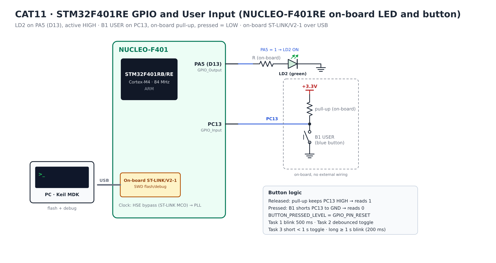

# EXPERIMENT DETAILS

**EXP:** CONTINUOUS ASSESSMENT 11

**DATE:** 14/10/2026

**NAME OF EXP:** STM32F401RE Cortex-M4: GPIO and User Input Programming

**HARDWARE SETUP / PLATFORM:** STM32 NUCLEO-F401RE (STM32F401, ARM Cortex-M4) + STM32CubeMX + Keil MDK · on-board user LED LD2 (PA5) · on-board user button B1 (PC13) · on-board ST-LINK/V2-1

---

## TASK 11B : On-board Switch Control with State Remembrance (Task 2)

### 1. Circuit Diagram

The on-board push button B1 controls the on-board LED LD2. Each valid press toggles the LED, and the LED keeps (remembers) its state after the button is released. No external components are needed.

- **Development Board:** NUCLEO-F401RE (on-board ST-LINK/V2-1 for programming and debugging over USB)
- **Microcontroller:** STM32F401 (ARM Cortex-M4 with FPU), CubeMX device STM32F401RBTx (LQFP64)
- **Clock:** HSE in bypass mode → PLL (M = 25, N = 168, P = 2) → 84 MHz SYSCLK on the CubeMX clock tree
- **LED (output):** LD2 (green) on PA5 (D13), push-pull output, active HIGH
- **Button (input):** B1 USER (blue) on PC13, GPIO input with no internal pull. The board has its own pull-up, and B1 connects PC13 to GND, so the pin reads 1 when released and 0 when pressed (active LOW).
- **Programming / Debug:** on-board ST-LINK/V2-1 over SWD (PA13 SWDIO, PA14 SWCLK)

### 2. Core Logic / Pseudocode / Code Base

**Working Principle:**

The LED is driven from a remembered variable (`led_state`), not from the button level. The button only generates an event, so releasing it does not change the LED.

`Button_ScanPressEvent()` is a non-blocking debounce state machine. It records the `HAL_GetTick()` time of every raw level change and accepts a new level only after it has been stable for `DEBOUNCE_MS` = 30 ms. It returns 1 once, on the released → pressed transition, and the main loop then calls `Led_Toggle()`. Contact bounce and a held button therefore produce exactly one toggle per press.

`Button_IsPressed()` hides the active-LOW wiring: it returns 1 when PC13 reads `BUTTON_PRESSED_LEVEL` (`GPIO_PIN_RESET`). At start-up the debounce state is seeded with the current button level, so a button held during reset does not count as a press.

**Pseudocode:**

1. Initialise HAL, clock and GPIO.
2. `button_stable = button_raw_last = Button_IsPressed()`, `button_change_tick = now`, `Led_Write(0)`.
3. Forever:
   - `raw = Button_IsPressed()`
   - if `raw ≠ button_raw_last` → `button_raw_last = raw`, `button_change_tick = now`
   - if `now − button_change_tick ≥ 30 ms` and `button_raw_last ≠ button_stable`:
     - `button_stable = button_raw_last`
     - if pressed → `Led_Toggle()` (LED state is remembered)

**Code Base:** [`Core/Src/main.c`](Core/Src/main.c)

- `BUTTON_PORT / BUTTON_PIN = GPIOC / GPIO_PIN_13`, `BUTTON_PRESSED_LEVEL = GPIO_PIN_RESET`: B1 is active LOW.
- `DEBOUNCE_MS 30u`: stability window for a new button level.
- `Button_ScanPressEvent()`: debounce + press-edge detection.
- `Led_Toggle()`: `HAL_GPIO_TogglePin(GPIOA, GPIO_PIN_5)` and updates `led_state`.
- CubeMX configuration: [`LAB_11_TASK2.ioc`](LAB_11_TASK2.ioc) · Keil project: [`MDK-ARM/LAB_11_TASK2.uvprojx`](MDK-ARM/LAB_11_TASK2.uvprojx)

### 3. Inference

Every press of B1 toggles LD2 exactly once, and LD2 stays in its new state after the button is released (press → ON, press → OFF).

Treating the press as an edge event instead of a level is what gives the state memory. The on-board pull-up on PC13 is why no internal pull is configured, and the 30 ms debounce, measured with `HAL_GetTick()`, removes contact bounce without blocking the loop.
