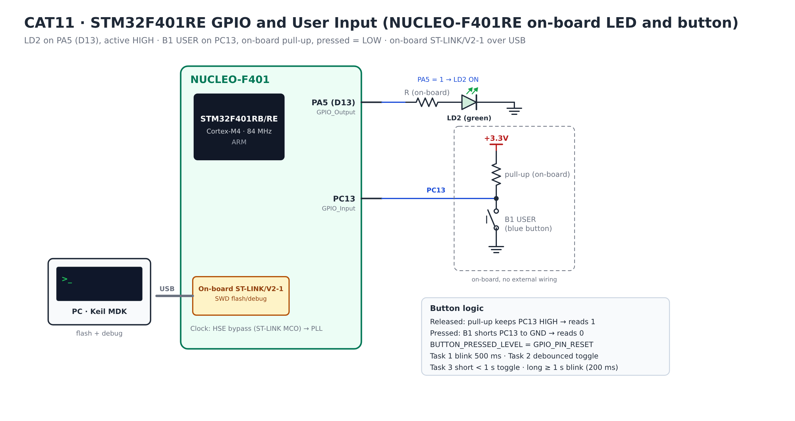

# EXPERIMENT DETAILS

**EXP:** CONTINUOUS ASSESSMENT 11

**DATE:** 14/10/2026

**NAME OF EXP:** STM32F401RE Cortex-M4: GPIO and User Input Programming

**HARDWARE SETUP / PLATFORM:** STM32 NUCLEO-F401RE (STM32F401, ARM Cortex-M4) + STM32CubeMX + Keil MDK · on-board user LED LD2 (PA5) · on-board user button B1 (PC13) · on-board ST-LINK/V2-1

---

## TASK 11C : Short-Press and Long-Press Detection (Task 3)

### 1. Circuit Diagram

The application distinguishes a short press from a long press of B1 and performs a different action on LD2 for each. No external components are needed.

- **Development Board:** NUCLEO-F401RE (on-board ST-LINK/V2-1 for programming and debugging over USB)
- **Microcontroller:** STM32F401 (ARM Cortex-M4 with FPU), CubeMX device STM32F401RBTx (LQFP64)
- **Clock:** HSE in bypass mode → PLL (M = 25, N = 168, P = 2) → 84 MHz SYSCLK on the CubeMX clock tree
- **LED (output):** LD2 (green) on PA5 (D13), push-pull output, active HIGH
- **Button (input):** B1 USER on PC13, GPIO input with no internal pull, on-board pull-up, active LOW (pressed = 0)
- **Programming / Debug:** on-board ST-LINK/V2-1 over SWD (PA13 SWDIO, PA14 SWCLK)

### 2. Core Logic / Pseudocode / Code Base

**Actions:**

| Press | Duration | Action |
|---|---|---|
| Short press | < 1 s | Toggle LD2 |
| Long press | ≥ 1 s | Toggle continuous blinking mode (LD2 toggles every 200 ms while it is on) |

**Working Principle:**

The press duration is measured without blocking. `Button_ScanEvent()` debounces B1 for 30 ms like Task 2. On the debounced press it only stores the start time (`press_start_tick = HAL_GetTick()`) and returns no event. On the debounced release it computes `now − press_start_tick` and returns `BUTTON_EVENT_SHORT_PRESS` if that is below `LONG_PRESS_MS` (1000 ms), otherwise `BUTTON_EVENT_LONG_PRESS`.

- `Handle_ShortPress()`: toggles LD2.
- `Handle_LongPress()`: toggles blink mode. Entering it starts with LD2 on; leaving it turns LD2 off.
- `Blink_Update()`: runs on every loop pass and, in blink mode, toggles LD2 whenever 200 ms (`BLINK_HALF_MS`) have passed since the last toggle.

Because nothing in the loop waits, the blinking continues smoothly while the button is held.

**Pseudocode:**

1. Initialise HAL, clock and GPIO; seed the debounce variables; `blink_mode = 0`; LD2 off.
2. Forever:
   - `event = Button_ScanEvent()`
     - debounced press → `press_start_tick = now`
     - debounced release → duration < 1000 ms ? SHORT : LONG
   - SHORT → toggle LD2; LONG → toggle blink mode
   - if `blink_mode` and `now − blink_tick ≥ 200 ms` → toggle LD2, `blink_tick = now`

**Code Base:** [`Core/Src/main.c`](Core/Src/main.c)

- `ButtonEvent_t`: `BUTTON_EVENT_NONE`, `BUTTON_EVENT_SHORT_PRESS`, `BUTTON_EVENT_LONG_PRESS`.
- `DEBOUNCE_MS 30u`, `LONG_PRESS_MS 1000u`, `BLINK_HALF_MS 200u`: timing constants.
- `Button_ScanEvent()`: debounce and press-duration classification on release.
- `Handle_ShortPress()`, `Handle_LongPress()`, `Blink_Update()`: the actions in the table above.
- CubeMX configuration: [`LAB_11_TASK3.ioc`](LAB_11_TASK3.ioc) · Keil project: [`MDK-ARM/LAB_11_TASK3.uvprojx`](MDK-ARM/LAB_11_TASK3.uvprojx)

### 3. Inference

A short press of B1 toggles LD2, and holding B1 for at least 1 s starts continuous blinking; another long press stops it with LD2 off.

Classifying the press on release, from `HAL_GetTick()` time stamps, avoids any blocking delay: the CPU keeps running the loop while the button is held, so other work (here, the blinking) is never interrupted. The same structure scales to more press types (double press, very long press) by adding duration thresholds.
