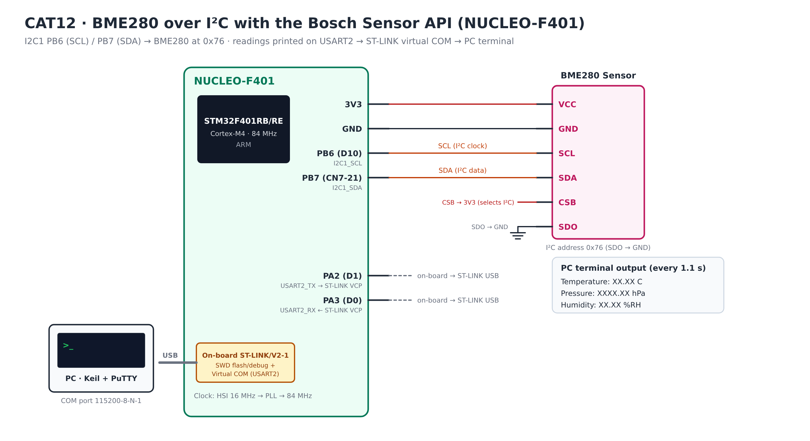
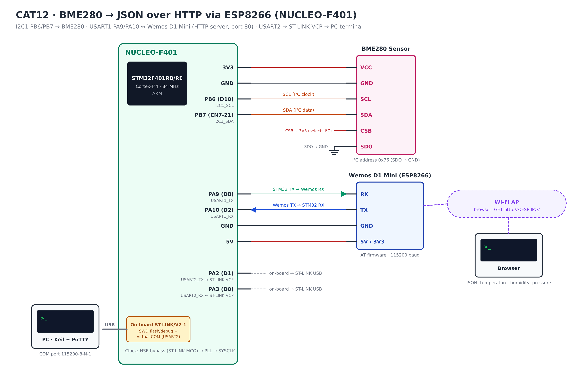

# EXPERIMENT DETAILS

**EXP:** CONTINUOUS ASSESSMENT 12

**DATE:** 23/10/2026

**NAME OF EXP:** Sensor Interfacing (BME280) – STM32 (Debug) – ESP8266 (Wi-Fi) HTTP – Node Analytics: BME280 Sensor Interfacing Using I²C and Bosch Sensor API

**HARDWARE SETUP / PLATFORM:** STM32 NUCLEO-F401 (STM32F401, Cortex-M4) + BME280 sensor + Wemos D1 Mini (ESP8266, AT firmware) + STM32CubeMX + Keil MDK + Bosch Sensortec BME280 Sensor API v3.5.1

| Folder | Task |
|---|---|
| [`TASKA_BME280_I2C_UART`](TASKA_BME280_I2C_UART) | TASK 12A · BME280 over I²C with the Bosch Sensor API, readings on the UART terminal |
| [`TASKB_HTTP_JSON_RESPONSE`](TASKB_HTTP_JSON_RESPONSE) | TASK 12B · Raw HTTP response with BME280 data (JSON) served through the ESP8266 |

Both folders are complete STM32CubeMX + Keil MDK projects (`.ioc`, `Core/`, `Drivers/`, `MDK-ARM/`). The Bosch driver files `bme280.c`, `bme280.h` and `bme280_defs.h` are placed in `Core/Src` and `Core/Inc` and added to the Keil project, as described in the lab sheet.

---

## TASK 12A : BME280 Sensor Interfacing Using I²C and the Bosch Sensor API

### 1. Circuit Diagram

The BME280 is connected to I2C1 of the Nucleo. Compensated temperature, pressure and humidity are printed on the PC terminal through the ST-LINK virtual COM port (USART2).

- **Development Board:** NUCLEO-F401 (on-board ST-LINK/V2-1 for programming, debugging and virtual COM port)
- **Microcontroller:** STM32F401 (ARM Cortex-M4)
- **Clock:** HSI 16 MHz → PLL → 84 MHz SYSCLK
- **I²C:** I2C1, SCL = PB6 (D10), SDA = PB7 (CN7-21), 100 kHz standard mode
- **Sensor:** BME280 at I²C address 0x76 (SDO → GND), CSB → 3.3 V (I²C mode), VCC = 3.3 V, GND
- **UART:** USART2, PA2 (TX) / PA3 (RX) → ST-LINK virtual COM port, 115200-8-N-1



### 2. Core Logic / Pseudocode / Code Base

**Working Principle:**

The Bosch Sensor API does all of the sensor-specific work: chip-ID check, reading the factory trim (calibration) data, configuration and compensation. It reaches the hardware only through three functions that the application supplies, which together form the porting layer:

| Bosch API needs | Implementation |
|---|---|
| read registers | `user_i2c_read()` → `HAL_I2C_Mem_Read(&hi2c1, addr << 1, reg, …)` |
| write registers | `user_i2c_write()` → `HAL_I2C_Mem_Write(&hi2c1, addr << 1, reg, …)` |
| delay | `user_delay_us()` → `HAL_Delay()` (µs rounded up to ms) |

The 7-bit address 0x76 is shifted left by one because the HAL expects the 8-bit form. The sensor runs in normal mode (continuous measurements, 1000 ms standby), and `bme280_get_sensor_data()` returns values that are already compensated.

**Pseudocode:**

1. Initialise HAL, the clock, GPIO, I2C1 and USART2.
2. `HAL_I2C_IsDeviceReady()` at 0x76; if there is no reply → print an error and stop.
3. Fill the `bme280_dev` structure: interface = I²C, `intf_ptr` = address, read / write / delay = porting functions.
4. `bme280_init()` → reads chip ID (must be 0x60) and the trim data.
5. Settings: oversampling ×1 for T, P and H, IIR filter off, standby 1000 ms → `bme280_set_sensor_settings()`.
6. `bme280_set_sensor_mode(BME280_POWERMODE_NORMAL)`.
7. Every 1.1 s: `bme280_get_sensor_data(BME280_ALL)` → print temperature (°C), pressure (hPa) and humidity (%RH).

**Code Base:** [`TASKA_BME280_I2C_UART/Core/Src/main.c`](TASKA_BME280_I2C_UART/Core/Src/main.c)

- `BME280_Init()`: device structure set-up, `bme280_init()`, chip-ID check, settings and power mode.
- `user_i2c_read()` / `user_i2c_write()` / `user_delay_us()`: STM32 HAL porting layer for the Bosch driver.
- `BME280_PrintData()`: converts the readings to fixed-point (×100) and prints them without floating-point `printf`.
- `UART_Print()`: blocking string output on USART2.
- CubeMX: [`bme280_testing.ioc`](TASKA_BME280_I2C_UART/bme280_testing.ioc) · Keil: [`MDK-ARM/bme280_testing.uvprojx`](TASKA_BME280_I2C_UART/MDK-ARM/bme280_testing.uvprojx) · Firmware: [`bme280_testing.hex`](TASKA_BME280_I2C_UART/MDK-ARM/bme280_testing/bme280_testing.hex)

**Output (PC terminal):**

```text
STM32 BME280 PROJECT
Starting sensor initialization...
BME280 initialization successful
Sensor ID verified: 0x60
BME280 configured successfully
Temperature: XX.XX C
Pressure: XXXX.XX hPa
Humidity: XX.XX %RH
-----------------------------
```

### 3. Inference

I²C communication with the BME280 is established, the chip ID 0x60 is read correctly, and the Bosch API produces valid compensated temperature, pressure and humidity values every 1.1 s. The values change when the sensor's environment changes (for example, breathing on it raises the humidity).

The porting layer keeps the vendor driver independent of the microcontroller: only three small functions are STM32-specific. Using the Bosch compensation instead of rewriting the equations avoids calibration mistakes.

---

## TASK 12B : Raw HTTP Response with BME280 Data

### 1. Circuit Diagram

The same BME280 connection as TASK 12A, plus a Wemos D1 Mini on USART1. The ESP8266 runs a TCP server on port 80, and the STM32 answers each browser request with a JSON HTTP response built from the latest readings.

- **Development Board:** NUCLEO-F401
- **Microcontroller:** STM32F401 (ARM Cortex-M4)
- **Clock:** HSE bypass input from the ST-LINK → PLL (CubeMX configuration)
- **I²C:** I2C1, SCL = PB6, SDA = PB7, 100 kHz → BME280 at 0x76
- **Wi-Fi UART:** USART1, PA9 (D8) TX → Wemos RX, PA10 (D2) RX ← Wemos TX, 115200-8-N-1, common GND
- **Debug UART:** USART2 → ST-LINK virtual COM port, 115200-8-N-1
- **Wi-Fi Module:** Wemos D1 Mini (ESP8266) with AT firmware, station mode on the campus 2.4 GHz network



### 2. Core Logic / Pseudocode / Code Base

**Working Principle:**

After setting up the sensor (chip-ID check, `bme280_init()`, settings, normal mode), the STM32 configures the ESP8266 with AT commands and starts a server:

| Command | Purpose |
|---|---|
| `AT`, `ATE0` | Check the modem, turn command echo off |
| `AT+CWMODE=1` | Station mode |
| `AT+CWJAP="<ssid>","<password>"` | Join the Wi-Fi network |
| `AT+CIFSR` | Print the IP address to open in the browser |
| `AT+CIPMUX=1` | Allow multiple connections (needed for a server) |
| `AT+CIPSERVER=1,80` | Start the TCP server on port 80 |

In the main loop the sensor is read and printed. For the next second the firmware watches USART1 for `+IPD,`, which the ESP8266 sends when a browser request arrives. When it sees one:

1. It reads the link id that follows `+IPD,` and discards the rest of the HTTP request.
2. It builds the JSON body, `{"status":"success","temperature":…,"humidity":…,"pressure":…}`.
3. It measures the body with `strlen()` to fill in the Content-Length header.
4. It builds the full response: status line, headers, blank line, body.
5. It sends `AT+CIPSEND=<id>,<total length>`, waits for the `>` prompt, sends the response, waits for `SEND OK`, then closes the link with `AT+CIPCLOSE=<id>`.

**Pseudocode:**

1. Sensor set-up as in TASK 12A (direct chip-ID read at register 0xD0 first, then the Bosch API).
2. Wi-Fi set-up: `AT` → `ATE0` → `AT+CWMODE=1` → `AT+CWJAP` (20 s timeout) → `AT+CIFSR` → `AT+CIPMUX=1` → `AT+CIPSERVER=1,80`.
3. Loop:
   - `bme280_get_sensor_data()` → temperature, pressure (Pa → hPa), humidity; print them
   - wait up to 1 s for `+IPD,`; if it arrives, call `serve_http()`

**Code Base:** [`TASKB_HTTP_JSON_RESPONSE/Core/Src/main.c`](TASKB_HTTP_JSON_RESPONSE/Core/Src/main.c)

- `at_cmd()`: sends an AT command, waits for `OK` (or `ERROR` / `FAIL`) and echoes the reply to the PC terminal.
- `wifi_wait()`: collects ESP8266 bytes until a given token appears or the timeout expires (`HAL_GetTick()`-based).
- `serve_http()`: builds the JSON payload and HTTP response, sends them with `AT+CIPSEND`, then `AT+CIPCLOSE`.
- `user_i2c_read()` / `user_i2c_write()` / `user_delay_us()`: Bosch API porting layer.
- CubeMX: [`Nucleo_and_bme280.ioc`](TASKB_HTTP_JSON_RESPONSE/Nucleo_and_bme280.ioc) · Keil: [`MDK-ARM/Nucleo_and_bme280.uvprojx`](TASKB_HTTP_JSON_RESPONSE/MDK-ARM/Nucleo_and_bme280.uvprojx) (build in Keil to generate the `.hex`)

**HTTP response sent to the browser:**

```text
HTTP/1.1 200 OK
Content-Type: application/json
Content-Length: <strlen(json)>
Connection: close

{"status":"success","temperature":28.45,"humidity":62.30,"pressure":1008.72}
```

### 3. Inference

Opening `http://<ESP8266 IP>/` in a browser on the same network returns the live BME280 readings as JSON, and every reading is also shown on the PC terminal.

Content-Length must equal the exact byte length of the JSON body, which changes with the values, so it is computed with `strlen()` each time rather than hard-coded. The ESP8266 handles Wi-Fi and TCP, while the STM32 only exchanges AT commands and builds the HTTP text, so a small microcontroller can act as a web data source.
