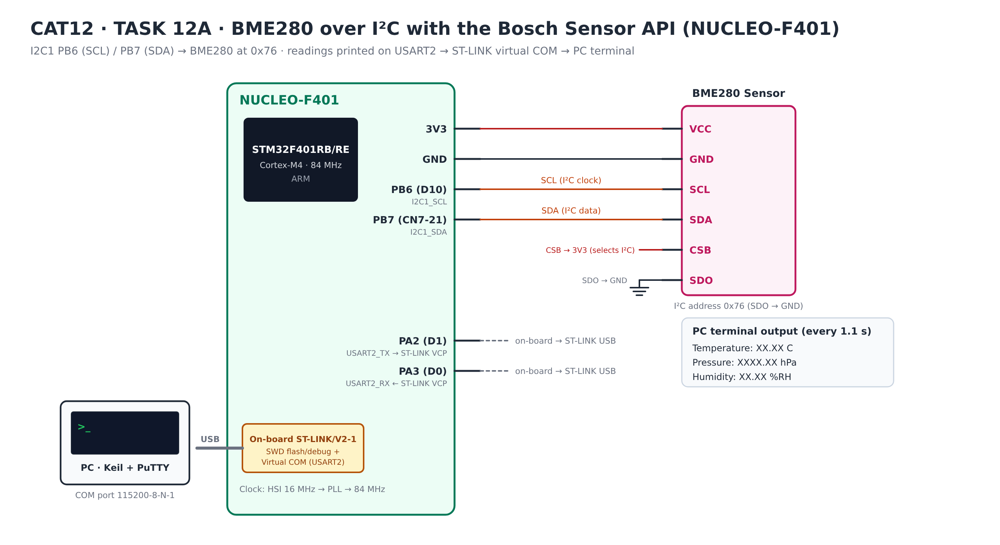

# EXPERIMENT DETAILS

**EXP:** CONTINUOUS ASSESSMENT 12

**DATE:** 23/10/2026

**NAME OF EXP:** Sensor Interfacing (BME280) – STM32 (Debug) – ESP8266 (Wi-Fi) HTTP – Node Analytics: BME280 Sensor Interfacing Using I²C and Bosch Sensor API

**HARDWARE SETUP / PLATFORM:** STM32 NUCLEO-F401 (STM32F401, Cortex-M4) + BME280 sensor + Wemos D1 Mini (ESP8266, AT firmware) + STM32CubeMX + Keil MDK + Bosch Sensortec BME280 Sensor API v3.5.1

> The Bosch Sensortec driver files `bme280.c`, `bme280.h` and `bme280_defs.h` (BME280_SensorAPI) are placed in `Core/Src` and `Core/Inc` and added to the Keil project, as described in the lab sheet.

---

## TASK 12A : BME280 Sensor Interfacing Using I²C and the Bosch Sensor API

### 1. Circuit Diagram

The BME280 is connected to I2C1 of the Nucleo. Compensated temperature, pressure and humidity are printed on the PC terminal through the ST-LINK virtual COM port (USART2).

- **Development Board:** NUCLEO-F401 (on-board ST-LINK/V2-1 for programming, debugging and virtual COM port)
- **Microcontroller:** STM32F401 (ARM Cortex-M4)
- **Clock:** HSI 16 MHz → PLL → 84 MHz SYSCLK
- **I²C:** I2C1, SCL = PB6 (D10), SDA = PB7 (CN7-21), 100 kHz standard mode
- **Sensor:** BME280 at I²C address 0x76 (SDO → GND), CSB → 3.3 V (I²C mode), VCC = 3.3 V, GND
- **UART:** USART2, PA2 (TX) / PA3 (RX) → ST-LINK virtual COM port, 115200-8-N-1



### 2. Core Logic / Pseudocode / Code Base

**Working Principle:**

The Bosch Sensor API does all of the sensor-specific work: chip-ID check, reading the factory trim (calibration) data, configuration and compensation. It reaches the hardware only through three functions that the application supplies, which together form the porting layer:

| Bosch API needs | Implementation |
|---|---|
| read registers | `user_i2c_read()` → `HAL_I2C_Mem_Read(&hi2c1, addr << 1, reg, …)` |
| write registers | `user_i2c_write()` → `HAL_I2C_Mem_Write(&hi2c1, addr << 1, reg, …)` |
| delay | `user_delay_us()` → `HAL_Delay()` (µs rounded up to ms) |

The 7-bit address 0x76 is shifted left by one because the HAL expects the 8-bit form. The sensor runs in normal mode (continuous measurements, 1000 ms standby), and `bme280_get_sensor_data()` returns values that are already compensated.

**Pseudocode:**

1. Initialise HAL, the clock, GPIO, I2C1 and USART2.
2. `HAL_I2C_IsDeviceReady()` at 0x76; if there is no reply → print an error and stop.
3. Fill the `bme280_dev` structure: interface = I²C, `intf_ptr` = address, read / write / delay = porting functions.
4. `bme280_init()` → reads chip ID (must be 0x60) and the trim data.
5. Settings: oversampling ×1 for T, P and H, IIR filter off, standby 1000 ms → `bme280_set_sensor_settings()`.
6. `bme280_set_sensor_mode(BME280_POWERMODE_NORMAL)`.
7. Every 1.1 s: `bme280_get_sensor_data(BME280_ALL)` → print temperature (°C), pressure (hPa) and humidity (%RH).

**Code Base:** [`Core/Src/main.c`](Core/Src/main.c)

- `BME280_Init()`: device structure set-up, `bme280_init()`, chip-ID check, settings and power mode.
- `user_i2c_read()` / `user_i2c_write()` / `user_delay_us()`: STM32 HAL porting layer for the Bosch driver.
- `BME280_PrintData()`: converts the readings to fixed-point (×100) and prints them without floating-point `printf`.
- `UART_Print()`: blocking string output on USART2.
- CubeMX: [`bme280_testing.ioc`](bme280_testing.ioc) · Keil: [`MDK-ARM/bme280_testing.uvprojx`](MDK-ARM/bme280_testing.uvprojx) · Firmware: [`bme280_testing.hex`](MDK-ARM/bme280_testing/bme280_testing.hex)

**Output (PC terminal):**

```text
STM32 BME280 PROJECT
Starting sensor initialization...
BME280 initialization successful
Sensor ID verified: 0x60
BME280 configured successfully
Temperature: XX.XX C
Pressure: XXXX.XX hPa
Humidity: XX.XX %RH
-----------------------------
```

### 3. Inference

I²C communication with the BME280 is established, the chip ID 0x60 is read correctly, and the Bosch API produces valid compensated temperature, pressure and humidity values every 1.1 s. The values change when the sensor's environment changes (for example, breathing on it raises the humidity).

The porting layer keeps the vendor driver independent of the microcontroller: only three small functions are STM32-specific. Using the Bosch compensation instead of rewriting the equations avoids calibration mistakes.
