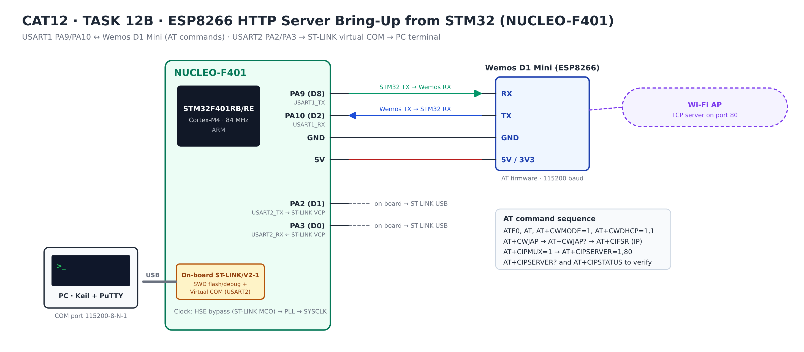

# EXPERIMENT DETAILS

**EXP:** CONTINUOUS ASSESSMENT 12

**DATE:** 23/10/2026

**NAME OF EXP:** Sensor Interfacing (BME280) – STM32 (Debug) – ESP8266 (Wi-Fi) HTTP – Node Analytics: BME280 Sensor Interfacing Using I²C and Bosch Sensor API

**HARDWARE SETUP / PLATFORM:** STM32 NUCLEO-F401 (STM32F401, Cortex-M4) + Wemos D1 Mini (ESP8266, AT firmware) + STM32CubeMX + Keil MDK · PC terminal over the ST-LINK virtual COM port

---

## TASK 12B : ESP8266 HTTP Server Bring-Up

### 1. Circuit Diagram

A continuation of the STM32–Wemos AT-command experiment, now on the Nucleo. The STM32 joins the Wi-Fi network through the ESP8266 and starts a TCP (HTTP) server on port 80. Every command and every reply is echoed to the PC terminal.

- **Development Board:** NUCLEO-F401 (on-board ST-LINK/V2-1 for programming, debugging and virtual COM port)
- **Microcontroller:** STM32F401 (ARM Cortex-M4)
- **Clock:** HSE bypass input from the ST-LINK → PLL (CubeMX configuration)
- **Wi-Fi UART:** USART1, PA9 (D8) TX → Wemos RX, PA10 (D2) RX ← Wemos TX, 115200-8-N-1, common GND
- **Debug UART:** USART2, PA2 / PA3 → ST-LINK virtual COM port → PC terminal, 115200-8-N-1
- **Wi-Fi Module:** Wemos D1 Mini (ESP8266) running AT firmware, 5 V / 3.3 V from the board

### 2. Core Logic / Pseudocode / Code Base

**Working Principle:**

For every command, the STM32:

1. Sends it to the ESP8266 on USART1.
2. Copies the same text to the PC on USART2, so the terminal shows what was sent.
3. Collects the reply with `HAL_UARTEx_ReceiveToIdle()`, which returns as soon as the line goes idle.
4. Forwards the reply to the PC.

Joining the access point is slow, so `AT+CWJAP` gets a 30 s reply timeout and a 10 s settle time before the connection is checked.

| Step | Command | Purpose | Timeout |
|---|---|---|---|
| 1 | `ATE0` | Turn command echo off (cleaner replies) | 2 s |
| 2 | `AT` | Check the modem responds with `OK` | 2 s |
| 3 | `AT+CWMODE=1` | Station mode | 2 s |
| 4 | `AT+CWDHCP=1,1` | Enable DHCP in station mode | 2 s |
| 5 | `AT+CWJAP="<ssid>","<password>"` | Join the access point | 30 s (+10 s wait) |
| 6 | `AT+CWJAP?` | Confirm the connected AP | 5 s |
| 7 | `AT+CIFSR` | Read the station IP and MAC address | 5 s |
| 8 | `AT+CIPMUX=1` | Multiple connections (required for server mode) | 3 s |
| 9 | `AT+CIPSERVER=1,80` | Start the TCP server on port 80 (HTTP) | 3 s |
| 10 | `AT+CIPSERVER?` | Verify the server configuration | 3 s |
| 11 | `AT+CIPSTATUS` | Check the TCP connection status | 3 s |

**Pseudocode:**

1. Initialise HAL, clock, GPIO, USART1 (ESP8266) and USART2 (PC).
2. For each command in the table:
   - send it on USART1 and copy it to USART2
   - `ReceiveToIdle` on USART1 with that step's timeout
   - if `len > 0`, send the reply to USART2
   - delay before the next command
3. Main loop idle; the ESP8266 now accepts connections on `<STAIP>:80`.

**Code Base:** [`Core/Src/main.c`](Core/Src/main.c)

- `cmd0` … `cmd10`: the AT command strings, each ending in `\r\n`.
- `HAL_UART_Transmit(&huart1, …)` / `HAL_UART_Transmit(&huart2, …)`: ESP8266 link and PC echo.
- `HAL_UARTEx_ReceiveToIdle(&huart1, rx, sizeof(rx), &len, timeout)`: variable-length reply capture into a 1000-byte buffer.
- CubeMX: [`newboard.ioc`](newboard.ioc) · Keil: [`MDK-ARM/newboard.uvprojx`](MDK-ARM/newboard.uvprojx) · Firmware: [`MDK-ARM/newboard/newboard.hex`](MDK-ARM/newboard/newboard.hex)

### 3. Inference

The terminal shows the module joining the network (`WIFI CONNECTED`, `WIFI GOT IP`), its station IP from `AT+CIFSR`, and `OK` for `AT+CIPMUX=1` and `AT+CIPSERVER=1,80`. The ESP8266 is now listening for TCP connections on port 80. When a browser opens `http://<STAIP>/`, the request arrives at the STM32 as `+IPD,<id>,<len>:…`, and an HTTP response can then be sent back with `AT+CIPSEND` (completed with live sensor data in TASK 12C).

Server mode needs `AT+CIPMUX=1` first, and the echo-off command keeps each reply free of the command text.
