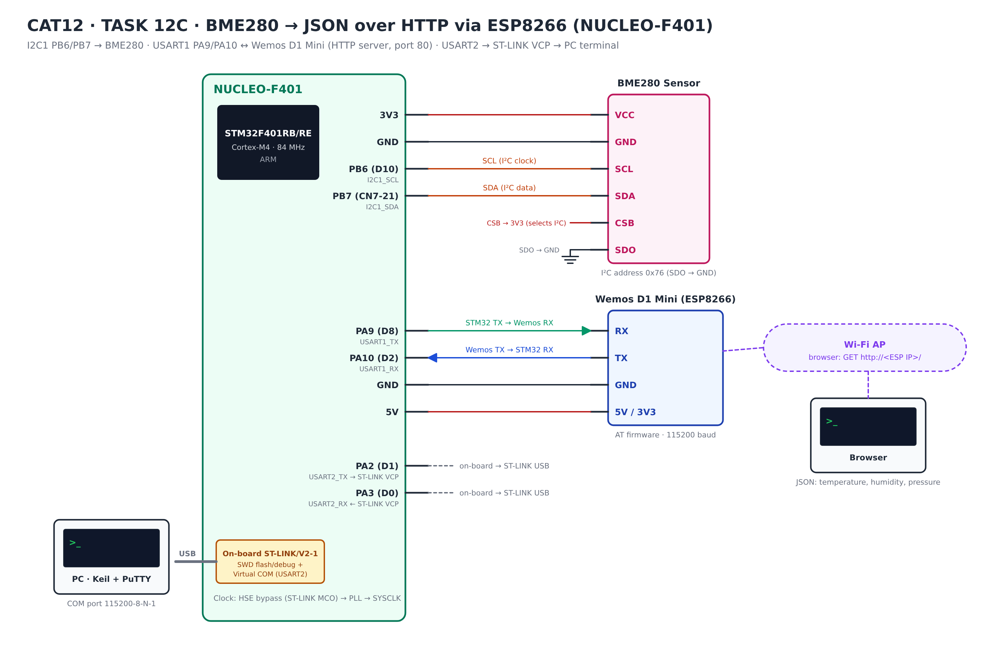

# EXPERIMENT DETAILS

**EXP:** CONTINUOUS ASSESSMENT 12

**DATE:** 23/10/2026

**NAME OF EXP:** Sensor Interfacing (BME280) – STM32 (Debug) – ESP8266 (Wi-Fi) HTTP – Node Analytics: BME280 Sensor Interfacing Using I²C and Bosch Sensor API

**HARDWARE SETUP / PLATFORM:** STM32 NUCLEO-F401 (STM32F401, Cortex-M4) + BME280 sensor + Wemos D1 Mini (ESP8266, AT firmware) + STM32CubeMX + Keil MDK + Bosch Sensortec BME280 Sensor API v3.5.1

> The Bosch Sensortec driver files `bme280.c`, `bme280.h` and `bme280_defs.h` (BME280_SensorAPI) are placed in `Core/Src` and `Core/Inc` and added to the Keil project, as described in the lab sheet.

---

## TASK 12C : Raw HTTP Response with BME280 Data

### 1. Circuit Diagram

The BME280 connection from TASK 12A combined with the ESP8266 HTTP server from TASK 12B: the Wemos D1 Mini on USART1 runs a TCP server on port 80, and the STM32 answers each browser request with a JSON HTTP response built from the latest readings.

- **Development Board:** NUCLEO-F401
- **Microcontroller:** STM32F401 (ARM Cortex-M4)
- **Clock:** HSE bypass input from the ST-LINK → PLL (CubeMX configuration)
- **I²C:** I2C1, SCL = PB6, SDA = PB7, 100 kHz → BME280 at 0x76
- **Wi-Fi UART:** USART1, PA9 (D8) TX → Wemos RX, PA10 (D2) RX ← Wemos TX, 115200-8-N-1, common GND
- **Debug UART:** USART2 → ST-LINK virtual COM port, 115200-8-N-1
- **Wi-Fi Module:** Wemos D1 Mini (ESP8266) with AT firmware, station mode on the campus 2.4 GHz network



### 2. Core Logic / Pseudocode / Code Base

**Working Principle:**

After setting up the sensor (chip-ID check, `bme280_init()`, settings, normal mode), the STM32 configures the ESP8266 with AT commands and starts a server:

| Command | Purpose |
|---|---|
| `AT`, `ATE0` | Check the modem, turn command echo off |
| `AT+CWMODE=1` | Station mode |
| `AT+CWJAP="<ssid>","<password>"` | Join the Wi-Fi network |
| `AT+CIFSR` | Print the IP address to open in the browser |
| `AT+CIPMUX=1` | Allow multiple connections (needed for a server) |
| `AT+CIPSERVER=1,80` | Start the TCP server on port 80 |

In the main loop the sensor is read and printed. For the next second the firmware watches USART1 for `+IPD,`, which the ESP8266 sends when a browser request arrives. When it sees one:

1. It reads the link id that follows `+IPD,` and discards the rest of the HTTP request.
2. It builds the JSON body, `{"status":"success","temperature":…,"humidity":…,"pressure":…}`.
3. It measures the body with `strlen()` to fill in the Content-Length header.
4. It builds the full response: status line, headers, blank line, body.
5. It sends `AT+CIPSEND=<id>,<total length>`, waits for the `>` prompt, sends the response, waits for `SEND OK`, then closes the link with `AT+CIPCLOSE=<id>`.

**Pseudocode:**

1. Sensor set-up as in TASK 12A (direct chip-ID read at register 0xD0 first, then the Bosch API).
2. Wi-Fi set-up: `AT` → `ATE0` → `AT+CWMODE=1` → `AT+CWJAP` (20 s timeout) → `AT+CIFSR` → `AT+CIPMUX=1` → `AT+CIPSERVER=1,80`.
3. Loop:
   - `bme280_get_sensor_data()` → temperature, pressure (Pa → hPa), humidity; print them
   - wait up to 1 s for `+IPD,`; if it arrives, call `serve_http()`

**Code Base:** [`Core/Src/main.c`](Core/Src/main.c)

- `at_cmd()`: sends an AT command, waits for `OK` (or `ERROR` / `FAIL`) and echoes the reply to the PC terminal.
- `wifi_wait()`: collects ESP8266 bytes until a given token appears or the timeout expires (`HAL_GetTick()`-based).
- `serve_http()`: builds the JSON payload and HTTP response, sends them with `AT+CIPSEND`, then `AT+CIPCLOSE`.
- `user_i2c_read()` / `user_i2c_write()` / `user_delay_us()`: Bosch API porting layer.
- CubeMX: [`Nucleo_and_bme280.ioc`](Nucleo_and_bme280.ioc) · Keil: [`MDK-ARM/Nucleo_and_bme280.uvprojx`](MDK-ARM/Nucleo_and_bme280.uvprojx) (build in Keil to generate the `.hex`)

**HTTP response sent to the browser:**

```text
HTTP/1.1 200 OK
Content-Type: application/json
Content-Length: <strlen(json)>
Connection: close

{"status":"success","temperature":28.45,"humidity":62.30,"pressure":1008.72}
```

### 3. Inference

Opening `http://<ESP8266 IP>/` in a browser on the same network returns the live BME280 readings as JSON, and every reading is also shown on the PC terminal.

Content-Length must equal the exact byte length of the JSON body, which changes with the values, so it is computed with `strlen()` each time rather than hard-coded. The ESP8266 handles Wi-Fi and TCP, while the STM32 only exchanges AT commands and builds the HTTP text, so a small microcontroller can act as a web data source.
