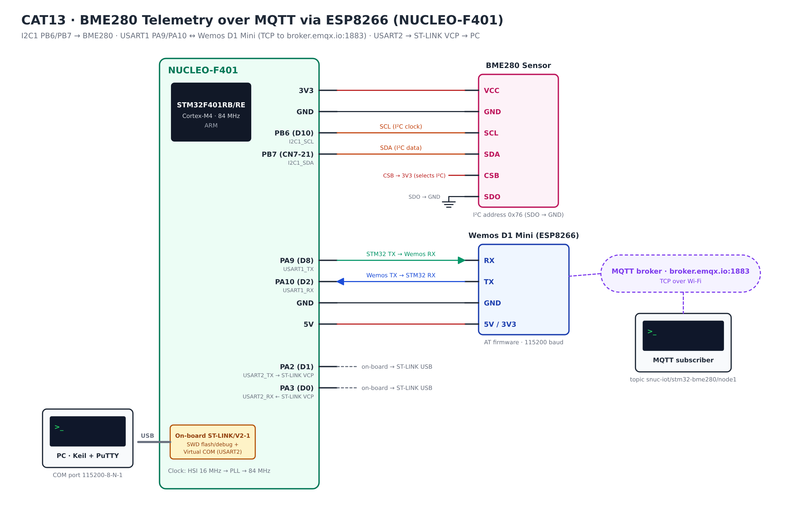

# EXPERIMENT DETAILS

**EXP:** CONTINUOUS ASSESSMENT 13

**DATE:** 27/10/2026

**NAME OF EXP:** Sensor Interfacing (BME280) – (MQTT) – Node Analytics: BME280 Sensor Interfacing Using I²C and MQTT

**HARDWARE SETUP / PLATFORM:** STM32 NUCLEO-F401 (STM32F401, Cortex-M4) + BME280 sensor + Wemos D1 Mini (ESP8266, AT firmware) + STM32CubeMX + Keil MDK + Bosch Sensortec BME280 Sensor API · public MQTT broker `broker.emqx.io`

---

## TASK 13 : BME280 Telemetry Publishing over MQTT

### 1. Circuit Diagram

A continuation of CAT12. The compensated BME280 readings are published as JSON to an MQTT broker every 5 s, so Node-RED (an `mqtt in` node) or any MQTT client can subscribe to them.

- **Development Board:** NUCLEO-F401 (on-board ST-LINK/V2-1 for programming, debugging and virtual COM port)
- **Microcontroller:** STM32F401 (ARM Cortex-M4)
- **Clock:** HSI 16 MHz → PLL → 84 MHz SYSCLK
- **I²C:** I2C1, SCL = PB6 (D10), SDA = PB7 (CN7-21), 100 kHz → BME280 at 0x76 (SDO → GND, CSB → 3.3 V)
- **Wi-Fi UART:** USART1, PA9 (D8) TX → Wemos RX, PA10 (D2) RX ← Wemos TX, 115200-8-N-1, receive interrupt + ring buffer, common GND
- **Debug UART:** USART2 → ST-LINK virtual COM port, 115200-8-N-1
- **Wi-Fi Module:** Wemos D1 Mini (ESP8266) with AT firmware, used as a TCP pipe to the broker
- **Broker:** `broker.emqx.io`, TCP port 1883 · topic `snuc-iot/stm32-bme280/node1`



### 2. Core Logic / Pseudocode / Code Base

**Working Principle:**

The ESP8266 AT firmware only opens a plain TCP connection, so the STM32 builds the MQTT 3.1.1 packets itself and sends them as raw bytes with `AT+CIPSEND`:

| Packet | Built by | Content |
|---|---|---|
| CONNECT | `MQTT_BuildConnect()` | Protocol "MQTT" level 4, clean session, keep-alive 60 s, client ID = `stm32-bme280-` + 8 hex digits derived from the STM32 96-bit unique ID |
| CONNACK | `MQTT_HandleIncoming()` | Expected `20 02 00 00` (connection accepted) |
| PUBLISH | `MQTT_BuildPublish()` | QoS 0, topic `snuc-iot/stm32-bme280/node1`, JSON payload |
| PINGREQ | `MQTT_Ping()` | `C0 00`, sent when idle for half the keep-alive time |

The packet's remaining-length field uses MQTT's variable-length encoding (`MQTT_EncodeLength()`).

Data from the ESP8266 is received with a USART1 interrupt into a 2048-byte ring buffer, so nothing is lost while the main loop is busy. `ESP_Pump()` splits the stream into text lines (command replies) and `+IPD` frames. A small state machine (`IPD_IDLE → IPD_HEADER → IPD_PAYLOAD`) reads exactly `<len>` binary bytes from each `+IPD` frame and passes them to the MQTT handler.

`MQTT_Process()` keeps the link alive without blocking:

- Wi-Fi down → re-run the ESP8266 initialisation every 5 s.
- Broker not connected → retry CONNECT every 5 s. After 5 failures in a row, re-join Wi-Fi.
- Connected → PUBLISH every 5 s, otherwise PINGREQ when the keep-alive interval is half used.

**Pseudocode:**

1. Initialise HAL, clock, GPIO, I2C1, USART1 (with RX interrupt) and USART2.
2. Check the BME280 with `HAL_I2C_IsDeviceReady()` → `BME280_Init()` (Bosch API, oversampling ×1, filter off, standby 1000 ms, normal mode).
3. Build a unique client ID from the STM32 96-bit UID.
4. `ESP8266_Init()`: `AT` handshake → `AT+CWMODE=1` → `AT+CWJAP` (prints the meaning of any `+CWJAP:<code>` error) → `AT+CIPMUX=0` → print the IP.
5. `MQTT_Connect()`: `AT+CIPSTART="TCP","broker.emqx.io",1883` → send CONNECT → wait for CONNACK.
6. Loop every 1.1 s:
   - `bme280_get_sensor_data()` → print the readings on the terminal
   - `MQTT_Process()` → publish / ping / reconnect

**Published payload (JSON):**

```json
{"temperature":28.45,"pressure":1008.72,"humidity":62.30}
```

**Code Base:** [`Core/Src/main.c`](Core/Src/main.c)

- `BME280_Init()`, `BME280_PrintData()`, `user_i2c_read()` / `user_i2c_write()` / `user_delay_us()`: sensor and Bosch porting layer.
- `USART1_IRQHandler()`, `ESP_RxStart()`, `ESP_RxRead()`: interrupt-driven receive into the ring buffer.
- `ESP_Command()`, `ESP_Handshake()`, `ESP_SendTCP()`, `ESP8266_Init()`: AT-command layer.
- `MQTT_BuildConnect()`, `MQTT_BuildPublish()`, `MQTT_EncodeLength()`, `MQTT_Connect()`, `MQTT_Publish()`, `MQTT_Ping()`, `MQTT_Process()`: MQTT client.
- CubeMX: [`MQTTandBME280.ioc`](MQTTandBME280.ioc) · Keil: [`MDK-ARM/MQTTandBME280.uvprojx`](MDK-ARM/MQTTandBME280.uvprojx) (build in Keil to generate the `.hex`)

**Terminal output (example):**

```text
STM32 BME280 MQTT PROJECT
Starting sensor initialization...
...
MQTT publish #1 -> snuc-iot/stm32-bme280/node1 : {"temperature":28.45,"pressure":1008.72,"humidity":62.30}
```

### 3. Inference

The node publishes a JSON reading every 5 s to `snuc-iot/stm32-bme280/node1` on `broker.emqx.io`. Subscribing to that topic, for example with an `mqtt in` node in Node-RED, receives the three parameters live for visualisation.

Building MQTT packets by hand shows what the protocol actually sends on the wire: CONNECT/CONNACK, PUBLISH and PINGREQ keep-alives. The interrupt ring buffer and the non-blocking `MQTT_Process()` state handling make the node recover on its own from Wi-Fi or broker drop-outs. Because a public broker is shared, the topic and client ID are made unique to this device.
