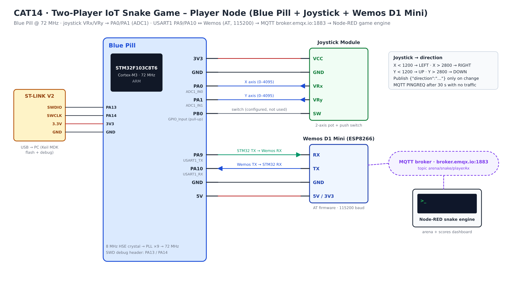

# EXPERIMENT DETAILS

**EXP:** CONTINUOUS ASSESSMENT 14 (End Semester Lab Evaluation)

**DATE:** 04/11/2026

**NAME OF EXP:** IoT Integration Platform – Node-RED: Two-Player Competitive IoT Snake Game

**HARDWARE SETUP / PLATFORM:** STM32 Blue Pill (STM32F103C8T6 @ 72 MHz) + analog joystick module + Wemos D1 Mini (ESP8266, AT firmware) + STM32CubeMX + Keil MDK · public MQTT broker `broker.emqx.io` · Node-RED game engine and dashboard

---

## TASK 14 : Level 1 – Two-Player Competitive IoT Game (Player Node)

### 1. Circuit Diagram

Two players share one playing field in Node-RED and steer separate snakes. Each player has an IoT node that sends direction commands over MQTT. This folder is the Player A node: an STM32 reads a joystick and publishes the direction through the ESP8266.

- **Development Board:** STM32 Blue Pill
- **Microcontroller:** STM32F103C8T6 (ARM Cortex-M3)
- **Clock:** 8 MHz HSE crystal → PLL ×9 → 72 MHz SYSCLK (APB1 36 MHz, APB2 72 MHz, ADC clock = PCLK2 ÷ 6 = 12 MHz)
- **Input interface:** 2-axis analog joystick, powered from 3.3 V so its outputs stay inside the 0–3.3 V ADC range
  - VRx → PA0 (ADC1_IN0), VRy → PA1 (ADC1_IN1)
  - SW → PB0 (GPIO input with pull-up; configured but not read by the firmware)
- **Serial communication:** USART1, PA9 TX → Wemos RX, PA10 RX ← Wemos TX, 115200-8-N-1, common GND; Wemos powered from 5 V
- **Communication platform:** Wemos D1 Mini (ESP8266) with AT firmware, used as a TCP pipe to the broker
- **Broker / topic:** `broker.emqx.io`, TCP port 1883 · topic `arena/snake/playerAx` · client ID `SNAKE_PLAYER_A_2026`
- **Programming / Debug:** ST-LINK V2 over SWD (PA13 SWDIO, PA14 SWCLK)

**Game rules (Level 1)**

| Item | Rule |
|---|---|
| Player A / Player B | Green snake / blue snake, each controlled by its own IoT node |
| Food | Shared by both players, 10 points per food item |
| Game over | A snake hits a wall, itself or the opponent's snake |
| Winner | The surviving player; if both collide in the same move, the result is a draw |
| Commands | `{"direction":"UP"}`, `{"direction":"DOWN"}`, `{"direction":"LEFT"}`, `{"direction":"RIGHT"}` |

### 2. Core Logic / Pseudocode / Code Base

**Input interface logic:**

`Read_ADC(channel)` selects the channel, runs one software-triggered conversion (sampling time 55.5 cycles) and returns a 12-bit value (0–4095). The joystick rests near the middle (≈ 2048). `Read_Joystick()` turns the two readings into a direction using a dead zone between `JOY_LOW` (1200) and `JOY_HIGH` (2800):

| Condition | Direction |
|---|---|
| X < 1200 | LEFT |
| X > 2800 | RIGHT |
| Y < 1200 | UP |
| Y > 2800 | DOWN |
| Both inside 1200–2800 | no change (the snake keeps its last direction) |

The X axis is checked first, so a diagonal push resolves to LEFT or RIGHT. `INVERT_Y` flips the Y axis if the module is mounted the other way up.

**Serial communication logic:**

`ESP_SendATWait(command, expected, timeout)` sends an AT command on USART1 and collects the reply byte by byte into a 180-byte sliding buffer. It returns true as soon as the expected text (for example `OK` or `>`) appears, and false on `ERROR`, `FAIL`, `CLOSED` or timeout. Every received byte is also passed to `ESP_ProcessReceivedByte()`, which watches for MQTT replies inside the TCP data.

**Communication layer (MQTT over ESP8266 AT):**

The AT firmware only gives a raw TCP connection, so the STM32 builds the MQTT 3.1.1 packets itself and sends each one with `AT+CIPSEND=<len>` → wait for `>` → raw bytes → wait for `SEND OK`.

| Packet | Bytes | Built in |
|---|---|---|
| CONNECT | `10`, remaining length, `"MQTT"`, level `04`, flags `02` (clean session), keep-alive 60 s, client ID | `MQTT_Connect()` |
| CONNACK | `20 02 00 00` (accepted), detected by a 4-byte sliding window | `ESP_ProcessReceivedByte()` |
| PUBLISH | `30` (QoS 0), remaining length, topic, JSON payload `{"direction":"…"}` | `MQTT_Publish()` |
| PINGREQ / PINGRESP | `C0 00` / `D0 00` | `MQTT_Ping()` |

Connection sequence in `ESP_Connect()`: `AT` → `ATE0` → `AT+CWMODE=1` → `AT+CWJAP="SNUC",…` → `AT+CIPMUX=0` → `AT+CIPMODE=0` → `AT+CIPSTART="TCP","broker.emqx.io",1883` → MQTT CONNECT → CONNACK.

**Notable code logic:**

- A direction is published only when it changes (`currentDirection` vs `previousDirection`), so the broker gets one message per turn instead of a stream every 100 ms.
- If nothing has been sent for 30 s, a PINGREQ keeps the broker connection alive (keep-alive is 60 s).
- Any failed step (Wi-Fi, TCP, CONNACK, PINGRESP) calls `Error_Handler()`, which stops the node so the fault is obvious during the demo.

**Node-RED side (game console):**

Two `mqtt in` nodes (Player A and Player B topics, output parsed JSON), an inject node `game/tick` every 150 ms and manual `game/start`, `game/stop` and `game/reset` injects all feed one Function node, the two-player snake engine (movement, collision, food, score, winner). Its output drives a `ui_template` node that draws the live arena: both snakes, the food, the scores and the game status.

**Pseudocode:**

1. `HAL_Init()`, `SystemClock_Config()` (72 MHz), GPIO, ADC1, USART1 (115200); wait 1 s; calibrate the ADC.
2. `ESP_Connect()`: join Wi-Fi, open TCP to the broker, send CONNECT, wait for CONNACK.
3. Forever, every 100 ms:
   - `Read_Joystick()` → `currentDirection`
   - if `currentDirection` is set and differs from `previousDirection` → `MQTT_Publish()`; on success remember it
   - if 30 s without traffic → `MQTT_Ping()` (stop on failure)

**Code Base:** [`Core/Src/main.c`](Core/Src/main.c)

- `WIFI_SSID`, `MQTT_BROKER`, `MQTT_PORT`, `MQTT_CLIENT_ID`, `MQTT_TOPIC`, `JOY_LOW`, `JOY_HIGH`, `INVERT_Y`, `MQTT_KEEPALIVE`: user settings at the top of the file.
- `Read_ADC()`, `Read_Joystick()`: input interface.
- `ESP_SendATWait()`, `ESP_SendRaw()`, `ESP_ProcessReceivedByte()`, `ESP_WaitMQTT()`, `ESP_Connect()`: ESP8266 AT layer.
- `MQTT_Connect()`, `MQTT_Publish()`, `MQTT_Ping()`: hand-built MQTT packets.
- CubeMX: [`player1.ioc`](player1.ioc) · Keil: [`MDK-ARM/player1.uvprojx`](MDK-ARM/player1.uvprojx) (build in Keil to generate the `.hex`)

### 3. Inference

Moving the joystick turns the Player A snake in the Node-RED arena: each new direction reaches the game engine as a single `{"direction":"…"}` MQTT message, and both players' nodes play on the same field through the shared broker.

Using the joystick's analog axes with a dead zone gives clean UP/DOWN/LEFT/RIGHT commands without debouncing, and sending only changes keeps network traffic and latency low. The node, the broker and the Node-RED engine are fully decoupled: the STM32 only knows its topic, and the game logic, timing (150 ms ticks) and display live in Node-RED.
