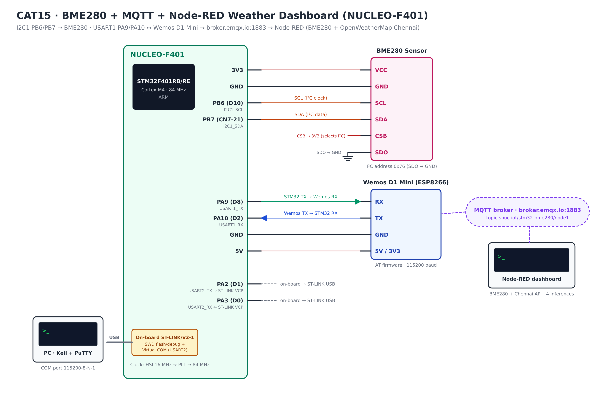
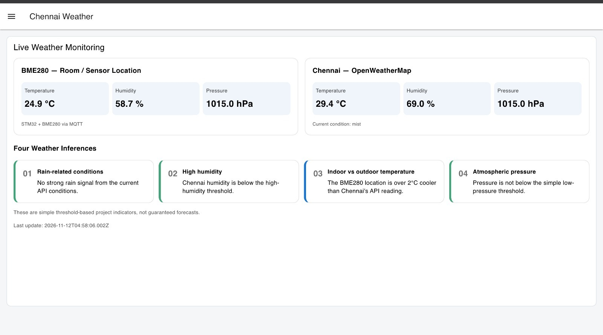

# EXPERIMENT DETAILS

**EXP:** CONTINUOUS ASSESSMENT 15

**DATE:** 12/11/2026

**NAME OF EXP:** Sensor Interfacing (BME280) – MQTT – Node-RED: Live Weather Monitoring Dashboard with Node Analytics

**HARDWARE SETUP / PLATFORM:** STM32 NUCLEO-F401 (STM32F401, Cortex-M4) + BME280 sensor + Wemos D1 Mini (ESP8266, AT firmware) + STM32CubeMX + Keil MDK + Bosch Sensortec BME280 Sensor API · public MQTT broker `broker.emqx.io` · Node-RED with Dashboard 2.0 · OpenWeatherMap current-weather API

---

## TASK 15 : Live Weather Monitoring Dashboard with Four Weather Inferences

### 1. Circuit Diagram

The BME280 node from CAT13 publishes room readings over MQTT. Node-RED combines them with Chennai's outdoor weather from OpenWeatherMap and shows both, with four simple weather inferences, on one dashboard page.

- **Development Board:** NUCLEO-F401 (on-board ST-LINK/V2-1 for programming, debugging and virtual COM port)
- **Microcontroller:** STM32F401 (ARM Cortex-M4)
- **Clock:** HSI 16 MHz → PLL → 84 MHz SYSCLK
- **I²C:** I2C1, SCL = PB6 (D10), SDA = PB7 (CN7-21), 100 kHz → BME280 at 0x76 (SDO → GND, CSB → 3.3 V)
- **Wi-Fi UART:** USART1, PA9 (D8) TX → Wemos RX, PA10 (D2) RX ← Wemos TX, 115200-8-N-1, common GND
- **Debug UART:** USART2 → ST-LINK virtual COM port, 115200-8-N-1
- **Wi-Fi Module:** Wemos D1 Mini (ESP8266) with AT firmware, used as a TCP pipe to the broker
- **Broker / topics:** `broker.emqx.io`, TCP port 1883 · `snuc-iot/stm32-bme280/node1` (BME280) · `snuc-iot/chennai/weather` (API readings, published by Node-RED)
- **IoT integration platform:** Node-RED flow [`NodeRED_Chennai_Weather_Flow.json`](NodeRED_Chennai_Weather_Flow.json), dashboard page "Chennai Weather"



### 2. Core Logic / Pseudocode / Code Base

**STM32 node (sensor → MQTT):**

The firmware is the CAT13 BME280 MQTT node. It reads the BME280 through the Bosch Sensor API, builds MQTT 3.1.1 packets by hand and sends them through the ESP8266 with `AT+CIPSEND`. Every 5 s it publishes:

```json
{"temperature":24.90,"pressure":1015.00,"humidity":58.70}
```

to `snuc-iot/stm32-bme280/node1` (QoS 0), with PINGREQ keep-alives and automatic reconnects (see CAT13/TASK13 for the packet details).

**Node-RED flow:**

| Node | Type | Role |
|---|---|---|
| Every 5 seconds | inject | Starts an API request every 5 s (also once at deploy) |
| Build Chennai API URL | function | Builds the OpenWeatherMap URL for `q=Chennai,IN`, `units=metric` with the API key |
| GET OpenWeatherMap | http request | Calls the API; the response is parsed as a JSON object |
| Extract API readings | function | Keeps temperature, humidity, pressure, condition and description; checks they are numbers |
| Publish Chennai API MQTT | mqtt out | Publishes the API reading to `snuc-iot/chennai/weather` (retained) |
| BME280 MQTT input | mqtt in | Subscribes to `snuc-iot/stm32-bme280/node1` |
| Chennai API MQTT input | mqtt in | Subscribes to `snuc-iot/chennai/weather` |
| Combine readings + four inferences | function | Stores the latest reading from each source in flow context and computes the inferences |
| Six readings + four inferences | ui-template | Draws the two reading cards and the four inference cards |

Both sources arrive through MQTT, so the dashboard function handles the room sensor and the API in the same way. The latest values are kept in flow context (`weatherState`), and the page refreshes whenever either source sends a new reading.

**Four weather inferences (simple thresholds, not forecasts):**

| # | Inference | Rule |
|---|---|---|
| 01 | Rain-related conditions | API condition contains rain / drizzle / thunderstorm, **or** humidity ≥ 80 % and pressure ≤ 1005 hPa |
| 02 | High humidity | Chennai humidity ≥ 70 % |
| 03 | Indoor vs outdoor temperature | BME280 temperature more than 2 °C above or below the API temperature |
| 04 | Atmospheric pressure | Chennai pressure < 1008 hPa → relatively low, unsettled weather possible |

**Pseudocode:**

1. STM32: initialise the BME280 and the ESP8266, connect to the broker, then publish a JSON reading every 5 s.
2. Node-RED, every 5 s: request Chennai weather → extract the readings → publish them to `snuc-iot/chennai/weather`.
3. Node-RED, on any message from either topic:
   - parse the JSON and check the three numbers
   - store it as `bme` or `api` in flow context
   - evaluate the four rules and send `{bme, api, inferences}` to the dashboard template

**Dashboard output:**



| Source | Temperature | Humidity | Pressure |
|---|---|---|---|
| BME280 (room / sensor location) | 24.9 °C | 58.7 % | 1015.0 hPa |
| Chennai (OpenWeatherMap, condition: mist) | 29.4 °C | 69.0 % | 1015.0 hPa |

**Code Base:**

- STM32 firmware: [`Core/Src/main.c`](Core/Src/main.c) · CubeMX: [`MQTTandBME280.ioc`](MQTTandBME280.ioc) · Keil: [`MDK-ARM/MQTTandBME280.uvprojx`](MDK-ARM/MQTTandBME280.uvprojx) (build in Keil to generate the `.hex`)
- Node-RED flow: [`NodeRED_Chennai_Weather_Flow.json`](NodeRED_Chennai_Weather_Flow.json). Import it in Node-RED (needs `@flowfuse/node-red-dashboard`), then paste an OpenWeatherMap API key into the "Build Chennai API URL" node. The exported file keeps a placeholder instead of the key.

### 3. Inference

The dashboard shows the room readings from the STM32 node next to Chennai's outdoor readings, and updates live as new MQTT messages arrive. In the captured run:

- **Rain:** no rain signal (condition "mist", humidity below 80 %).
- **Humidity:** Chennai humidity (69 %) is just below the 70 % high-humidity threshold.
- **Temperature:** the BME280 location is 4.5 °C cooler than the outdoor reading, so inference 03 flags it.
- **Pressure:** both read 1015 hPa, above the 1008 hPa low-pressure threshold, which also shows that the BME280's pressure measurement agrees with the weather service.

Routing both the sensor and the web API through MQTT turns Node-RED into a small node-analytics layer: new sources can be added by publishing to a topic, and the inference rules live in one function node. The rules are simple thresholds and are labelled on the dashboard as indicators, not forecasts.
