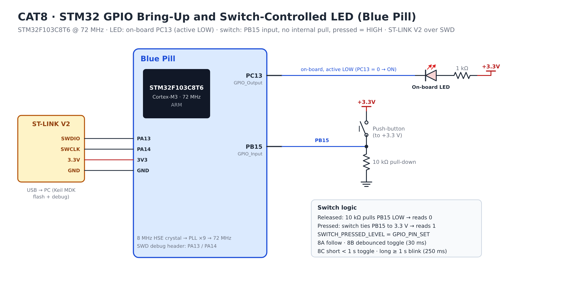

# EXPERIMENT DETAILS

**EXP:** CONTINUOUS ASSESSMENT 8

**DATE:** 18/09/2026

**NAME OF EXP:** STM32 GPIO Bring-Up and Switch-Controlled LED

**HARDWARE SETUP / PLATFORM:** STM32 Blue Pill (STM32F103C8T6 @ 72 MHz) + STM32CubeMX + Keil MDK · push-button on PB15 · on-board LED on PC13 · ST-LINK V2

---

## TASK 8A : GPIO Input/Output

### 1. Circuit Diagram

A push-button and an LED are interfaced with the STM32. The switch is read on PB15 and the on-board LED on PC13 follows the switch state.

- **Development Board:** STM32 Blue Pill
- **Microcontroller:** STM32F103C8T6 (ARM Cortex-M3)
- **Clock:** 8 MHz HSE crystal → PLL ×9 → 72 MHz SYSCLK (APB1 36 MHz, APB2 72 MHz)
- **LED (output):** on-board LED on PC13, push-pull output, active LOW (PC13 = 0 → LED ON)
- **Switch (input):** push-button between PB15 and +3.3 V, with an external 10 kΩ pull-down from PB15 to GND. PB15 is a GPIO input with no internal pull (`GPIO_NOPULL`), so it reads 0 when released and 1 when pressed.
- **Programming / Debug:** ST-LINK V2 over SWD (PA13 SWDIO, PA14 SWCLK)

**CubeMX pin configuration**

| Pin | Mode | Setting | Used for |
|---|---|---|---|
| PC13 | GPIO_Output | push-pull, no pull, low speed | on-board LED |
| PB15 | GPIO_Input | no pull-up / pull-down | push-button |
| PD0 / PD1 | RCC_OSC_IN / OSC_OUT | HSE crystal | 8 MHz clock source |
| PA13 / PA14 | SYS_JTMS-SWDIO / SYS_JTCK-SWCLK | Serial Wire | ST-LINK debug |

### 2. Core Logic / Pseudocode / Code Base

**Working Principle:**

The main loop polls PB15 with `HAL_GPIO_ReadPin()` on every pass. `Switch_IsPressed()` compares the pin level with `SWITCH_PRESSED_LEVEL` (`GPIO_PIN_SET`) and returns a logical pressed / released flag. `Led_Write()` converts a logical ON / OFF into the pin level the LED needs: the Blue Pill LED is active LOW, so ON writes `GPIO_PIN_RESET` to PC13.

Because there is no delay in the loop, the switch is sampled continuously and the LED mirrors it immediately: ON while the button is held, OFF as soon as it is released.

**Pseudocode:**

1. `HAL_Init()`, `SystemClock_Config()` (72 MHz), `MX_GPIO_Init()` (PC13 output, PB15 input).
2. `Led_Write(0)`: start with the LED off.
3. Forever:
   - if `Switch_IsPressed()` → `Led_Write(1)`
   - else → `Led_Write(0)`

**Code Base:** [`Core/Src/main.c`](Core/Src/main.c)

- `LED_PORT / LED_PIN = GPIOC / GPIO_PIN_13`, `LED_ON_LEVEL = GPIO_PIN_RESET`: active-LOW LED.
- `SWITCH_PORT / SWITCH_PIN = GPIOB / GPIO_PIN_15`, `SWITCH_PRESSED_LEVEL = GPIO_PIN_SET`: switch to 3.3 V.
- `Switch_IsPressed()`: `HAL_GPIO_ReadPin()` → 1 when pressed, 0 otherwise.
- `Led_Write(on)`: `HAL_GPIO_WritePin()` with the level for ON / OFF.
- CubeMX configuration: [`LAB_8A.ioc`](LAB_8A.ioc) · Keil project: [`MDK-ARM/LAB_8A.uvprojx`](MDK-ARM/LAB_8A.uvprojx)

### 3. Inference

The LED turns on while the push-button is held and turns off when it is released, which confirms the GPIO input (PB15) and output (PC13) configuration.

With no internal pull selected, the external pull-down is what holds PB15 at a defined LOW level when the switch is open; without it the input would float and read random values. The LED logic is written in terms of ON / OFF and the active-LOW detail is kept in one place (`LED_ON_LEVEL`), so the same code works for an active-HIGH LED by changing a single define.
