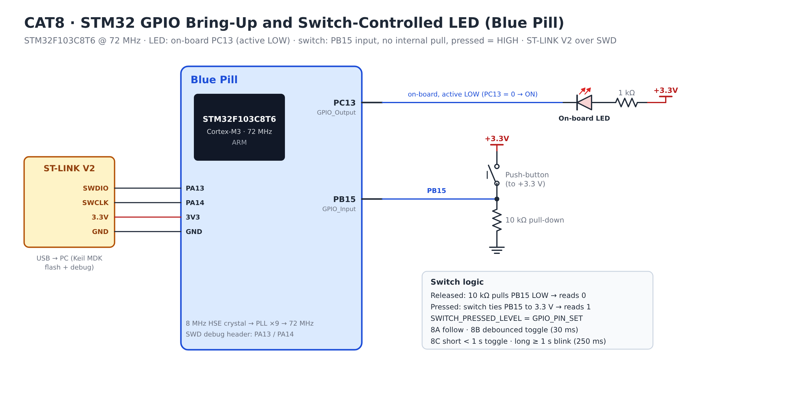

# EXPERIMENT DETAILS

**EXP:** CONTINUOUS ASSESSMENT 8

**DATE:** 18/09/2026

**NAME OF EXP:** STM32 GPIO Bring-Up and Switch-Controlled LED

**HARDWARE SETUP / PLATFORM:** STM32 Blue Pill (STM32F103C8T6 @ 72 MHz) + STM32CubeMX + Keil MDK · push-button on PB15 · on-board LED on PC13 · ST-LINK V2

---

## TASK 8B : Event-Based Control

### 1. Circuit Diagram

Same hardware as TASK 8A. Each valid press of the switch on PB15 toggles the on-board LED on PC13 once.

- **Development Board:** STM32 Blue Pill
- **Microcontroller:** STM32F103C8T6 (ARM Cortex-M3)
- **Clock:** 8 MHz HSE crystal → PLL ×9 → 72 MHz SYSCLK
- **LED (output):** on-board LED on PC13, push-pull output, active LOW (PC13 = 0 → LED ON)
- **Switch (input):** push-button between PB15 and +3.3 V, external 10 kΩ pull-down to GND, PB15 input with no internal pull (pressed = 1)
- **Programming / Debug:** ST-LINK V2 over SWD (PA13 SWDIO, PA14 SWCLK)

### 2. Core Logic / Pseudocode / Code Base

**Switch bounce:**

When a mechanical switch closes or opens, its contacts bounce for a few milliseconds (typically 1–20 ms), so the pin toggles several times before it settles. If every rising edge toggled the LED, one press could produce several toggles and the LED could end up in the wrong state.

**Working Principle (non-blocking software debounce):**

`Switch_ScanPressEvent()` is called on every pass of the main loop and keeps three variables:

| Variable | Meaning |
|---|---|
| `switch_raw_last` | last raw level read from PB15 |
| `switch_change_tick` | `HAL_GetTick()` time of the last raw change |
| `switch_stable` | debounced (accepted) state |

Every time the raw level changes, the time is noted. A new level is accepted only after it has stayed the same for `DEBOUNCE_MS` = 30 ms, so all the bounce edges inside that window are ignored. When the accepted state changes from released to pressed, the function returns 1 once, and the main loop calls `Led_Toggle()`. Holding the button gives no further events, because only the released → pressed transition counts.

At start-up the debounce variables are seeded with the current switch level, so a button already held at reset does not give a false press. The 30 ms wait is measured with `HAL_GetTick()`, not `HAL_Delay()`, so the loop never blocks.

**Pseudocode:**

1. Initialise HAL, clock and GPIO.
2. `switch_stable = switch_raw_last = Switch_IsPressed()`, `switch_change_tick = now`, `Led_Write(0)`.
3. Forever:
   - `raw = Switch_IsPressed()`
   - if `raw ≠ switch_raw_last` → `switch_raw_last = raw`, `switch_change_tick = now`
   - if `now − switch_change_tick ≥ 30 ms` and `switch_raw_last ≠ switch_stable`:
     - `switch_stable = switch_raw_last`
     - if `switch_stable == pressed` → `Led_Toggle()`

**Code Base:** [`Core/Src/main.c`](Core/Src/main.c)

- `DEBOUNCE_MS 30u`: stability window for a new switch level.
- `Switch_ScanPressEvent()`: debounce state machine; returns 1 only on a confirmed press edge.
- `Led_Toggle()`: `HAL_GPIO_TogglePin(GPIOC, GPIO_PIN_13)` and updates the remembered `led_state`.
- CubeMX configuration: [`LAB_8_TASKB.ioc`](LAB_8_TASKB.ioc) · Keil project: [`MDK-ARM/LAB_8_TASKB.uvprojx`](MDK-ARM/LAB_8_TASKB.uvprojx)

### 3. Inference

Each press toggles the LED exactly once, and the LED keeps its state after the button is released. Holding the button does not cause repeated toggling.

Without debouncing, a single press can register as several presses because of contact bounce. Requiring the input to stay stable for 30 ms filters the bounce, and using `HAL_GetTick()` instead of a blocking delay keeps the main loop free for other work.
