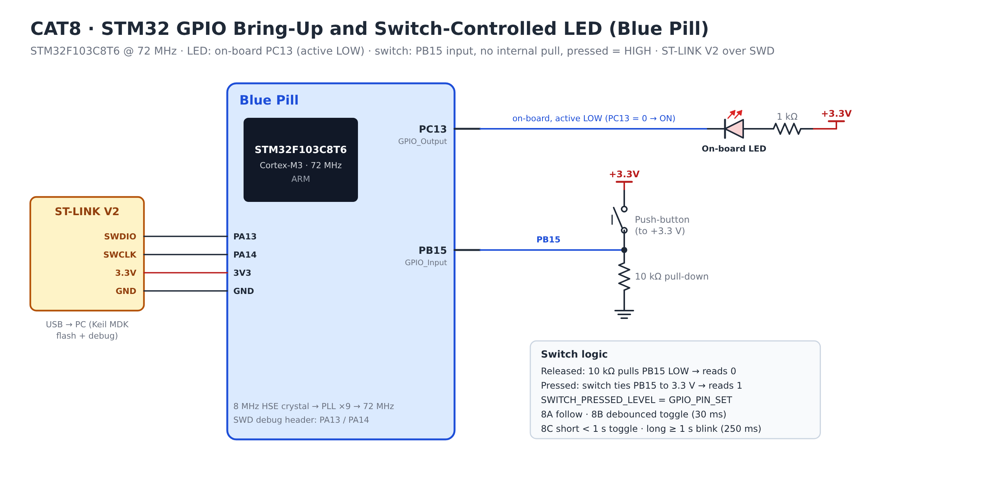

# EXPERIMENT DETAILS

**EXP:** CONTINUOUS ASSESSMENT 8

**DATE:** 18/09/2026

**NAME OF EXP:** STM32 GPIO Bring-Up and Switch-Controlled LED

**HARDWARE SETUP / PLATFORM:** STM32 Blue Pill (STM32F103C8T6 @ 72 MHz) + STM32CubeMX + Keil MDK · push-button on PB15 · on-board LED on PC13 · ST-LINK V2

---

## TASK 8C : Short Press vs Long Press

### 1. Circuit Diagram

Same hardware as TASK 8A. The firmware classifies each press of the switch on PB15 by how long it is held and drives the on-board LED on PC13 accordingly.

- **Development Board:** STM32 Blue Pill
- **Microcontroller:** STM32F103C8T6 (ARM Cortex-M3)
- **Clock:** 8 MHz HSE crystal → PLL ×9 → 72 MHz SYSCLK
- **LED (output):** on-board LED on PC13, push-pull output, active LOW (PC13 = 0 → LED ON)
- **Switch (input):** push-button between PB15 and +3.3 V, external 10 kΩ pull-down to GND, PB15 input with no internal pull (pressed = 1)
- **Programming / Debug:** ST-LINK V2 over SWD (PA13 SWDIO, PA14 SWCLK)

### 2. Core Logic / Pseudocode / Code Base

**Required behaviour:**

| User action | System response |
|---|---|
| Short press (< 1 s) | Toggle LED |
| Long press (≥ 1 s) | LED enters continuous blinking mode |
| Next short press | Stop blinking (LED off) |
| Long press again | Return to blinking mode |

**Working Principle:**

The lab sheet does not allow a blocking delay for long-press detection, so the press duration is measured with time stamps from `HAL_GetTick()`:

1. Button pressed → record the start time (`press_start_tick`).
2. The application keeps running (blinking continues while the button is held).
3. Button released → `duration = release time − press_start_tick`.
4. Classify: `duration < LONG_PRESS_MS` (1000 ms) → short press, otherwise → long press.

`Switch_ScanEvent()` uses the same 30 ms debounce as TASK 8B, and returns `BUTTON_EVENT_SHORT_PRESS` or `BUTTON_EVENT_LONG_PRESS` only on the release edge.

- `Handle_ShortPress()`: if blink mode is on, it stops blinking and turns the LED off; otherwise it toggles the LED.
- `Handle_LongPress()`: toggles blink mode. Entering blink mode starts with the LED on; leaving it turns the LED off.
- `Blink_Update()`: runs every loop pass and, in blink mode, toggles the LED each time 250 ms (`BLINK_HALF_MS`) has passed, giving a 2 Hz blink without `HAL_Delay()`.

**Pseudocode:**

1. Initialise HAL, clock and GPIO; seed the debounce variables; `blink_mode = 0`; LED off.
2. Forever:
   - `event = Switch_ScanEvent()`
     - on a debounced press → `press_start_tick = now`, no event
     - on a debounced release → `now − press_start_tick < 1000 ms` ? SHORT : LONG
   - SHORT → `Handle_ShortPress()`; LONG → `Handle_LongPress()`
   - `Blink_Update()`: if `blink_mode` and `now − blink_tick ≥ 250 ms` → toggle LED, `blink_tick = now`

**Code Base:** [`Core/Src/main.c`](Core/Src/main.c)

- `ButtonEvent_t`: `BUTTON_EVENT_NONE`, `BUTTON_EVENT_SHORT_PRESS`, `BUTTON_EVENT_LONG_PRESS`.
- `DEBOUNCE_MS 30u`, `LONG_PRESS_MS 1000u`, `BLINK_HALF_MS 250u`: timing constants.
- `Switch_ScanEvent()`: debounce + press-duration classification on release.
- `Handle_ShortPress()`, `Handle_LongPress()`, `Blink_Update()`: the actions in the table above.
- CubeMX configuration: [`LAB_8C.ioc`](LAB_8C.ioc) · Keil project: [`MDK-ARM/LAB_8C.uvprojx`](MDK-ARM/LAB_8C.uvprojx)

### 3. Inference

A quick press toggles the LED, a press held for at least 1 s switches the LED into continuous blinking, the next short press stops the blinking, and another long press returns to blinking mode, as listed in the table.

Because the duration is measured from time stamps and the loop never waits, the LED keeps blinking smoothly even while the button is being held. The press is classified only when the button is released, which is when its full duration is known.
