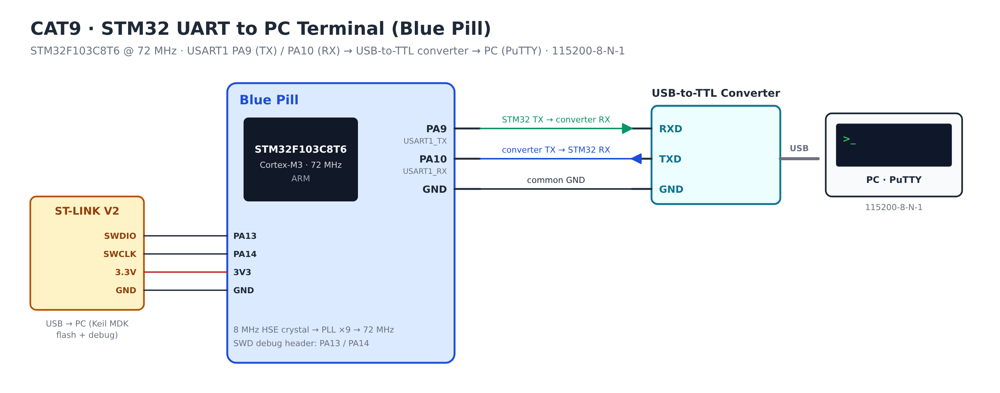

# EXPERIMENT DETAILS

**EXP:** CONTINUOUS ASSESSMENT 9

**DATE:** 28/09/2026

**NAME OF EXP:** STM32 UART Command Controlled LED

**HARDWARE SETUP / PLATFORM:** STM32 Blue Pill (STM32F103C8T6 @ 72 MHz) + STM32CubeMX + Keil MDK · USB-to-TTL converter · PC with PuTTY

---

## TASK 9A : Basic UART Communication (Transmit a Character)

### 1. Circuit Diagram

USART1 of the STM32 is set up in CubeMX for a standard serial configuration and connected to a PC terminal through a USB-to-TTL converter. The firmware sends one character to the PC over and over.

- **Development Board:** STM32 Blue Pill
- **Microcontroller:** STM32F103C8T6 (ARM Cortex-M3)
- **Clock:** 8 MHz HSE crystal → PLL ×9 → 72 MHz SYSCLK
- **UART:** USART1, TX = PA9, RX = PA10, asynchronous, 115200 baud, 8 data bits, no parity, 1 stop bit
- **Peripheral:** USB-to-TTL converter (STM32 TX → converter RXD, converter TXD → STM32 RX, common GND)
- **Programming / Debug:** ST-LINK V2 over SWD (PA13 SWDIO, PA14 SWCLK)
- **Host:** PC running PuTTY on the converter's COM port at 115200-8-N-1

### 2. Core Logic / Pseudocode / Code Base

**Working Principle:**

CubeMX generates `MX_USART1_UART_Init()`, which configures USART1 for 115200-8-N-1 using the HAL. In the main loop, `HAL_UART_Transmit()` sends the character `'A'` in blocking mode: the call returns only after the byte has been shifted out on PA9. Because the loop never stops, the PC terminal fills with a continuous stream of `A` characters.

**Pseudocode:**

1. `HAL_Init()`, `SystemClock_Config()` (72 MHz), `MX_GPIO_Init()`, `MX_USART1_UART_Init()`.
2. Store the character to send: `ch = 'A'`.
3. Forever: `HAL_UART_Transmit(&huart1, &ch, 1, HAL_MAX_DELAY)`.

**Code Base:** [`Core/Src/main.c`](Core/Src/main.c)

- `uint8_t ch = 'A';`: the byte transmitted.
- `HAL_UART_Transmit(&huart1, &ch, 1, HAL_MAX_DELAY)`: blocking transmit of 1 byte on USART1.
- `MX_USART1_UART_Init()`: CubeMX-generated UART set-up (`huart1`, 115200 baud, 8N1, TX/RX enabled).
- CubeMX configuration: [`lab9_uart_test.ioc`](lab9_uart_test.ioc) · Keil project: [`MDK-ARM/lab9_uart_test.uvprojx`](MDK-ARM/lab9_uart_test.uvprojx)
- Firmware: [`MDK-ARM/lab9_uart_test/lab9_uart_test.hex`](MDK-ARM/lab9_uart_test/lab9_uart_test.hex)

### 3. Inference

With PuTTY open on the converter's COM port at 115200-8-N-1, the terminal shows a continuous stream of `AAAA…`, confirming the UART link from the STM32 to the PC.

The HAL hides the register-level details (baud-rate divider, TXE flag), so a single `HAL_UART_Transmit()` call is enough to send data. The two ends must agree on baud rate and frame format, and the TX/RX lines must be crossed with a common ground. Blocking transmission keeps the CPU busy until each byte is sent, which is why interrupt- or DMA-based transmission is used in larger applications.
